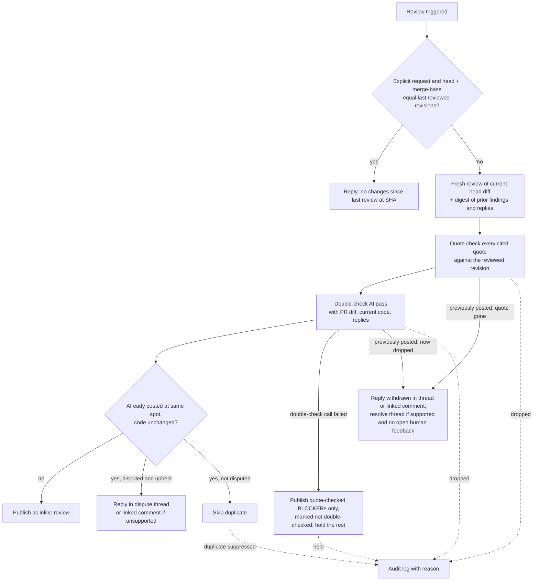

# Grounded Re-Reviews

## Problem Frame

On `bc3tech/sessionregistry` PR #66 (Gitea), the review bot posted the same false BLOCKER/HIGH finding in three
consecutive reviews: that `.gitea/workflows/publish-plugin.yml` used invalid Bash (`force_args=($RELEASE_FORCE)`,
`force_args+=(-Force -Confirm)`). That code never existed in any commit of the PR; every revision used
`force_args=()` / `force_args=(-Force -Confirm)`. The bot also filed a HIGH "bug" that described the fix the PR
made (409 → 428) rather than a defect, and repeated it after the author disputed it.

What the evidence shows:

- The first review (review 52, fresh session) was clean. Every bad finding came from repeat reviews.
- Repeat reviews in the standard review take a different path from first reviews. They replay the stored
  conversation (earlier prompts and the bot's own earlier rendered reviews) and append the new diff as a chat
  turn. The model anchors on its own prior output and re-asserts it rather than reading the current code.
- Findings are never checked against the code they cite. A quote that is absent from the file is posted anyway.
- Author replies disputing findings (inline replies and a PR comment with execution evidence) had no effect on
  the next review; identical findings were re-posted each time.
- Two of the three repeat reviews were requested with no new commits, producing duplicate noise.

The author perceived this as "reviewing the old diff". The actual cause is history anchoring plus no grounding
check. Either way the effect is the same: confidently wrong, repeated findings that erode trust in the bot.

## Review Flow

## Requirements

**Fresh review every time**
- R1. Every review, first or repeat, reviews the current head diff as a fresh review. It never replays the raw
  conversation transcript of earlier reviews as model input.
- R2. Repeat reviews receive a clearly labeled digest of the bot's earlier findings on this PR (location, quoted
  code, severity, the revision it was raised on) and any replies to them. The digest is presented as history to
  evaluate, not as current code.

**Evidence-backed findings**
- R3. Every line-anchored finding must include an exact quote of the current code it criticizes, as a
  structured part of the finding (not free text inside the body). A finding with a missing or empty quote fails
  the quote check.
- R4. Before publishing, a deterministic check confirms the quote appears in the reviewed revision of that file
  at or near the anchored line. Findings that fail are dropped. The check targets the code itself; a match that
  lands only in an unrelated spot (e.g., a different function that repeats the same text) does not count.
- R5. Review-wide findings (no single file/line anchor) must cite at least one file plus an exact quote as
  evidence. Every cited quote goes through the R4 check; a review-wide finding with no citations, or with any
  citation that fails, is dropped.

**Double-check pass**
- R6. A second AI pass examines each finding that survives the quote check, subject to R7's settings. It sees the PR diff, the current code
  around each anchor or citation, and any replies disputing the finding. It decides keep or drop. It drops
  findings that are not defects, including ones that describe what the PR intentionally fixed. Replies are
  treated as claims to verify against the code, not as evidence on their own.
- R7. The double-check pass is configurable per bot: on/off, the model to use, and the minimum severity it
  checks. Default: on, same model as the review, all severities. Findings below the minimum severity skip the
  double-check and are published once they pass the quote check. Disputed findings are always double-checked,
  whatever their severity and even when the double-check is turned off.
- R8. If the double-check call fails, the review publishes only BLOCKER findings that passed the quote check,
  each marked as not double-checked. All other findings are held (not published, logged per R13). The summary
  states that the double-check could not run. Duplicate suppression (R9) still applies. Previously posted
    findings whose quote fails R4 are still withdrawn (R10a). Other previously posted findings are left as they
    are: no withdrawal and no dispute reply. The review itself does not fail.

**Repeats and disputes**
- R9. A finding is not re-posted when the bot already raised the same issue at the same location and the code
  there has not changed.
- R10. Disputed findings are re-evaluated by the double-check pass on every review. If upheld and the code is
  unchanged, the bot replies in the existing dispute thread explaining why it still stands, without posting a
  duplicate finding. Disputes include replies in the finding's thread and PR-level comments that reference the
  finding.
- R10a. When a finding the bot posted on an earlier review (disputed or not) is dropped by the double-check, or
  its quote no longer passes R4, the bot replies in that finding's thread that it is withdrawn, with a short
  reason. It resolves the thread where the provider supports it, unless the thread holds unresolved non-bot
  feedback; then it leaves the thread open.
- R10b. On providers that cannot reply inside an existing thread, upheld-dispute and withdrawal replies are
  posted as a new comment that links to the original finding (stable link or comment ID). If the original can
  be edited, it is also marked as withdrawn.
- R11. If the code at a previously flagged location changed and the issue is still present, the bot posts a fresh
  finding with the new quote.

**Unchanged revisions**
- R12. When a review is explicitly requested (comment command, re-review request, reviewer re-request) and the
  head revision and effective diff base (merge-base) both equal the ones from the last review, the bot does not
  run a review. It replies "No changes since last review at `<sha>`." A change to the diff base triggers a normal
  review; a push to the target branch that leaves the merge-base unchanged does not count.

**Observability**
- R13. Every dropped or held finding (quote check, double-check, double-check failure, duplicate suppression) is
  recorded with its reason in the bot's run log/audit trail. Dropped and held findings are not shown on the PR,
  except for the withdrawal reply in R10a.

**Coverage**
- R14. R1–R13, R15 and R16 apply to both the standard review and the agentic review.
- R15. Head and base revisions are captured together when the review starts. The diff and all code the review,
  quote check, and double-check read are pinned to that pair. Neither path reads a moving branch tip. If either
  revision can't be read, the review stops rather than mixing revisions.
- R16. When the provider supplies no head/base revisions (e.g., Bitbucket today, unstable GitHub snapshots, or a
  snapshot error), the review still runs. The unchanged-revision skip (R12) is not applied. With no pinned
  revision, line-anchored quotes can't be verified, so findings go in the review summary only, not inline. They
  still go through the double-check pass. The summary says the findings could not be anchored.

## Success Criteria

- Replaying PR #66's sequence (initial review, push, `/review`, push, `/review`, dispute, `/review`) produces no
  `force_args` finding and no finding that merely describes the 409 → 428 fix.
- No finding is ever published whose quoted code does not exist in the reviewed revision.
- A `/review` with no head or merge-base change produces one short reply and no review.
- Disputed findings are not re-posted verbatim; an upheld dispute gets a thread reply instead.
- Every suppressed finding can be found in the audit trail with a reason.
- A previously posted finding that is now dropped gets a "withdrawn" reply (and a resolved thread where
  supported); no stale false finding is left standing.
- A labeled regression set passes on both the standard and agentic paths. It covers:
  - absent quotes
  - present-but-misattributed quotes
  - findings that describe the PR's intended fix
  - valid findings that must survive
  - disputes, both valid and false
  - double-check failure

## Scope Boundaries

- No change to how reviews are triggered or routed (unified in the inline-review work).
- No change to the conversational chat path for non-review @mentions.
- No UI for browsing dropped findings beyond the existing audit/run views.
- No automatic resolution of review threads other than withdrawals (R10a).
- No cross-PR learning (e.g., remembering that a pattern was a false positive in another PR).

## Key Decisions

- **Fresh review instead of conversational follow-up:** history anchoring is the root cause; a digest keeps the
  useful memory without letting prior output masquerade as current state.
- **Deterministic quote check before AI double-check:** cheap, catches fabricated code outright, and keeps the
  costlier pass for findings that are at least grounded.
- **Double-check on by default:** the user accepted the extra cost for correctness; configurability limits cost on
  bots that need it.
- **Drop silently, log for audit:** wrong findings on the PR cost trust; the audit trail preserves debuggability.
- **Double-check decides disputes:** avoids a rigid rule that either ignores valid pushback or caves to any
  reply; upheld findings answer in-thread rather than duplicating.
- **Skip unchanged revisions on explicit requests:** re-running on identical code mostly produced duplicate noise.
- **Double-check failure degrades, not fails:** only grounded BLOCKERs are worth the risk of being unchecked;
  everything else waits for a run where the double-check works. The summary is honest about the reduced check.
- **Withdraw rather than go silent:** a false finding left open keeps damaging trust even after the bot stops
  repeating it.
- **Same-model double-check is a second opinion, not proof:** the regression set decides whether the default
  is good enough.

## Dependencies / Assumptions

- Builds on the inline-review work (native file/line comments, unified review path, review snapshot of head/base).
- Assumes the bot can read its own prior inline comments and their replies on each provider (Gitea and GitHub
  verified in practice via review comment APIs; GitLab/Bitbucket unverified).
- Assumes the bot can determine the head and base revisions it last reviewed (Gitea reviews carry `commit_id`; persistence for
  other providers unverified).

## Outstanding Questions

### Deferred to Planning
- [Affects R2, R9, R11][Technical] Source of prior findings: the provider's review comments, the bot's own stored
  records, or both; and how "same issue at same location" is matched across revisions when lines move.
- [Affects R4][Technical] How strict the quote match is (whitespace normalization, multi-line quotes, how far from
  the anchored line).
- [Affects R6][Technical] Batch all findings in one double-check call vs one call per finding; token budget for
  large reviews.
- [Affects R7][Technical] Where per-bot settings live (bot admin form, existing review config properties).
- [Affects R12][Technical] Where the last reviewed revision is stored, and behavior after a force-push.
- [Affects R14][Needs research] How the agentic review currently uses history and whether its tool-based file
  reads change how R1/R3 apply.
- [Affects R10][Technical] What counts as a dispute (any non-bot reply in the thread vs. replies from allowed
  callers only), and how PR-level comments like the "validation context" note on PR #66 are matched to the
  findings they reference.
- [Affects R2, R10, R10a, R10b][Needs research] The provider interface has no way to reply in a thread and does
  not carry thread or parent identity on review comments today. Planning must add both, and confirm reply and
  resolve support on each of Gitea, GitHub, GitLab, and Bitbucket.
- [Affects R15][Technical] The agentic review prepares its workspace from the branch name rather than the
  snapshot's head SHA; it must be pinned.
- [Affects R10a, R10b][Needs research] No provider client can edit a comment or resolve a thread today. GitHub
  resolves threads only via GraphQL, which may need extra token scopes. Add per-provider capability flags and
  fall back to reply-only when a capability is missing.
- [Affects R13][Technical] Audit events exist, but `FINDING_SUPPRESSED` is deprecated and deferred, and
  `FINDING_POSTED` is logged once per review. R13 needs per-finding event types (suppressed, held, withdrawn)
  and a payload contract with finding, location, quote, stage, reason and revision. Decide whether the default
  90-day audit retention is acceptable.
- [Affects R12][Technical] `ReviewSnapshot.baseSha` means different things per provider: the branch tip on
  GitHub, and merge-base/start on Gitea and GitLab. Derive the effective diff base consistently, for GitHub via
  the merge-base or a diff hash.

## Next Steps

→ `/ce-plan` for structured implementation planning
