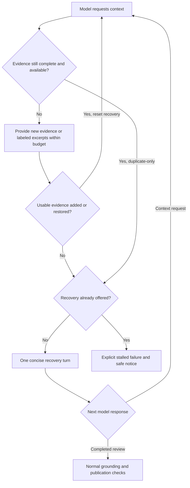

# Legacy Agentic Review Recovery

## Problem Frame

Capable local models can explore the repository but get stuck requesting the
same context instead of completing Agentic Review. Increasing limits prolongs
the stall and inflates the model prompt rather than improving review quality.
This phase repairs the existing legacy review path; it does not replace the
completed diagnostics-only scope in
`docs/brainstorms/2026-10-10-local-agentic-review-requirements.md`.

Read-only inspection of deployed run 128 on 2026-10-10 confirmed:

- The llama.cpp review consumed 10 context rounds and failed on turn 11 of a
  20-turn overall budget.
- There were 11 context-request occurrences, including 9 exact duplicates
  across 9 turns. A requestFiles batch counts as one occurrence, not one per file.
- Every returned turn had END_TURN. The final response used 36 output tokens
  against an 8,192-token cap; no provider-call failure occurred.
- The full request grew from 33,235 to 795,154 characters as large context
  messages accumulated. File-fetch caching did not prevent prompt replay.
- Token pressure triggered tool-message truncation on turn 10, but legacy
  file context is supplied as user messages. History compaction triggered on
  turn 11, after the last provider call and immediately before cap rejection.
- One failure notice was logged as delivered, and the FAILED run summary and
  diagnostic step were persisted.

Source inspection found a separate, concrete contract mismatch: final-review
instructions require fenced JSON, while llama.cpp's active grammar permits
only a bare JSON object. The review parser accepts either form. This conflict
is a plausible contributor to the stall, not a demonstrated root cause.
Raw provider transcripts were not captured, so precise model reasoning and
the repeated request contents remain unavailable.

## Requirements

**Consistent review contract**
- R1. In legacy Agentic Review, exploration and final-answer instructions must
  agree with the provider's enforced output format. For JSON-constrained
  llama.cpp, both phases accept one bare JSON object; final output contains
  the existing review summary and findings, with no remaining context request.
  Formal-decision metadata, when enabled, must also be expressible within the
  supported format without weakening existing decision gates.
- R2. Present clear, distinct examples of a context request and a completed
  review. State that previously supplied, still-available evidence should be
  used rather than requested again. Do not require a model/server upgrade,
  native function calling, or a different provider.

**Progress-aware repetition recovery**
- R3. Do not execute or replay an equivalent context request when its complete
  result remains available to the model at the same pinned revision. Return a
  concise acknowledgement that identifies the already-provided evidence and
  directs the model to use it. No repeated full context block is appended.
  Request identity ignores generated IDs and preserves meaningful argument,
  ordering, operation, and revision distinctions.
- R4. A duplicate-only turn receives one recovery turn, in which the model may
  finish its review or request genuinely new evidence. If that next turn is
  duplicate-only again, terminate with an explicit stalled-context failure.
  A turn that obtains new evidence breaks the consecutive duplicate-only
  sequence; existing overall/context budgets still bound the entire run.
  Progress means usable evidence actually delivered: merely executing a read,
  returning an error, or repeating an identical still-available excerpt does
  not reset recovery. Duplicate requests combined with such non-progress reads
  follow the same one-recovery-turn policy.
  A final answer must pass the normal completion and publication checks.
- R5. For mixed batches, suppress only requests whose complete evidence is
  still available and execute eligible requests. Evicted evidence and
  previously truncated regions remain eligible to be requested again.
  Overlapping file batches must not force replay of already-present full
  files. Merely cached or previously fetched evidence is not proof that the
  model currently has it. Failed or unavailable reads are not treated as
  complete evidence and remain subject to existing limits/failure handling.
  Repeating an oversized read that yields only already-present regions gets
  concise narrower-read guidance, not another copy of the same excerpt.

**Bounded, usable context**
- R6. Check the next request's context budget before sending it, accounting
  for review instructions, conversation, new evidence, and output headroom.
  Enforce the existing history/context settings for legacy user-message
  evidence, not only native tool messages. Do not rely on a failed provider
  request or a later returned turn to trigger normal budget enforcement.
  Use exact input sizing when available; otherwise apply a documented
  conservative estimate and margin to the complete effective request.
  Estimates are not proofs of provider-token fit. Retain existing bounded
  prompt-too-long compaction/retry as a last resort, not the normal budgeting
  mechanism.
- R7. Keep the active review task, pinned revision identity, required output
  contract, and a useful evidence inventory available through compaction.
  Evidence removed or truncated must no longer be considered fully available
  for duplicate suppression. Do not silently remove the task or substitute
  another revision's code.
  Validate suppression against the final effective request after new evidence
  insertion and compaction: retain the evidence an acknowledgement references,
  or invalidate that suppression and resolve the request again within budget.
- R8. Oversized file reads or batches return bounded excerpts labeled with
  their source, revision, included region, and omitted regions, plus guidance
  for narrower reads. Do not imply that an excerpt is a full file. If mandatory
  task/instructions and output headroom cannot fit even without optional
  context, fail explicitly instead of sending an oversized request.

**Safety and observable outcomes**
- R9. Preserve read-only tool enforcement, revision pinning, lease and
  cancellation fencing, grounding, stale-diff handling, degraded-approval
  guards, and existing successful publication/skip behavior. Do not convert
  an unfinished analysis into a completed review or formal decision. Do not
  raise exploration/output limits or automatically switch models.
  If a completed response leaves known requested evidence unavailable or
  incompletely read, publish it only as degraded: disclose those limitations
  in the summary and prohibit formal approval through the existing guards.
  Finding-level grounding alone does not prove adequate review coverage.
  Do not require exhaustive repository reads or treat every evicted file as
  unresolved if its relevant evidence was already adequately obtained.
  Context reads retain existing authorized-repository, pinned-ref, and
  read-only tool boundaries; recovery does not broaden access.
- R10. Retain privacy-safe failure notices and run diagnostics. Distinguish
  stalled repetition and insufficient mandatory context from existing budget
  exhaustion. Keep requested, executed, and suppressed context operations
  distinguishable; bounded recovery turns consume the overall turn budget,
  not an extra allowance. Notices remain at most one attempt per failed run.
  Do not enable raw transcript capture or expose request arguments, file
  paths, source contents, or prompts through added operator diagnostics.

## User Flow

Mixed batches follow R5: eligible evidence is provided alongside concise
acknowledgements, and reset recovery only when usable evidence is actually
delivered. Existing completion, budget, provider-failure, and cancellation paths
apply at every step.

## Success Criteria

- Contract checks show that exploration, final reviews, and enabled
  formal-decision metadata can be emitted under the active llama.cpp grammar;
  successful review output retains the existing parser/publication semantics.
- A deterministic analogue of run 128 requests two distinct context batches,
  then repeats still-available evidence. It receives one recovery turn and
  either completes, obtains new evidence, or fails explicitly on the next
  duplicate-only turn, rather than consuming 10 repeated context rounds.
- Repetition cases cover changed generated IDs, meaningful ref/argument
  changes, mixed and overlapping batches, evicted evidence, labeled excerpts,
  and failed reads. No unavailable evidence is falsely suppressed.
- Identical repeated excerpts and duplicate-plus-failed-read batches do not
  reset recovery. When new file B forces eviction of acknowledged file A,
  the final request either retains A or resolves its invalidated suppression;
  it never directs the model to evidence absent from the final request.
- A mixed request for available file A and new file B sends B plus a concise
  acknowledgement for A, not full A again. A later request for an omitted
  region remains eligible.
- Before each provider call, the effective request satisfies the configured
  context/history policy using exact accounting or the documented conservative
  estimate, with reserved output headroom. Large legacy evidence
  exercises this directly; validation measures the final provider request
  representation, not only message counts or successful HTTP delivery.
  Tests distinguish policy compliance from exact-token guarantees and retain
  coverage for the bounded provider prompt-too-long fallback.
- Compaction retains the review task, revision and output contract, accurately
  records what evidence remains usable, and does not make grounding approve
  unsupported findings.
- An otherwise valid zero-findings answer with known unresolved requested
  evidence is published as degraded with disclosed limitations, never as an
  unqualified clean review or formal approval. A stalled/incomplete response
  still fails rather than using degraded publication as a fallback.
- Existing successful reviews, native-mode behavior, clarification behavior,
  no-change/no-diff skips, cancellation, lease loss, and formal-decision
  safeguards remain covered without unintended behavior changes.
- After a separately authorized deployment, rerun the same PR/model/limits.
  Inspect whether the model completes a grounded review or reaches the bounded
  recovery failure. One successful live run is not evidence of universal
  model compatibility; deterministic tests establish the recovery guarantees.

## Scope Boundaries

- Behavioral changes target legacy full Agentic Review, regardless of provider.
  Shared helpers may change only while preserving other workflows' behavior.
  Clarification and native review are regression surfaces, not new recovery scope.
- No native llama.cpp transport or chat-template modernization, server upgrade,
  model substitution, higher budgets, general agent framework, new dashboard,
  raw transcript capture, or unrelated audit/privacy redesign.
- No claim that the grammar mismatch alone caused the stall, or that duplicate
  suppression guarantees a correct final review.
- This brainstorm documents requirements only. No implementation, server
  writes, deployment, or live review request is authorized by this document.

## Key Decisions

- Repair the existing legacy path instead of prompt-only repair or native-tool
  modernization: it addresses confirmed repetition and replay while keeping
  deployment compatibility and carrying cost bounded.
- One recovery turn per consecutive duplicate-only sequence: permit genuine
  progress, but do not spend the entire round budget re-sending known evidence.
- Availability-aware suppression: cache hits save I/O but do not establish
  that evidence remains in the model's effective context.
- Labeled excerpts rather than immediate failure for optional oversized reads:
  preserve useful exploration without silently claiming full coverage.
- Retain strict completion and grounding: recovery is an opportunity to finish,
  not permission to publish partial output or approve degraded analysis.
- Known unresolved evidence limitations allow publication of a completed but
  degraded review, with summary disclosure and no approval. They do not permit
  publication of unfinished analysis.
- Budgeting assumption pending user review: prefer conservative full-request
  estimates with margins and reserved output headroom when exact sizing is
  unavailable, retaining the existing bounded provider-error retry. Do not
  require new tokenizer infrastructure or claim estimates prove exact fit.
- Preserve the completed diagnostics requirements as a historical first phase.
  R3-R8 explicitly change the observation-only context behavior for this phase.

## Dependencies / Assumptions

- Current target includes the deployed stale-diff-awareness branch merged into
  diagnostics via commit 7c9b3ad6. Live run 128 exercises these diagnostics.
- Local requirements authoring follows the user's choice to start a separate
  requirements document. Server access remains strictly read-only.
- Exact tokenization and wire-shape budgeting require planning research.
  Where exact counts are unavailable, use a documented conservative policy;
  do not label character estimates as exact token counts.

## Outstanding Questions

### Deferred to Planning
- [Affects R1][Technical] How does enabled formal classification fit the bare
  envelope while preserving parser and decision compatibility?
- [Affects R3-R5, R7][Technical] What request/result metadata can track per-file
  and per-region availability through history compaction without storing raw
  arguments in emitted diagnostics?
- [Affects R6, R8][Needs research] How should effective request size and output
  headroom be bounded across legacy providers with differing templates and
  token-reporting capabilities, using existing configuration?
- [Affects R6-R8][Technical] How should excerpt limits and evidence retention
  work when mandatory context fits but a single optional read does not?
- [Affects R9][Technical] How should known unresolved requested evidence flow
  into existing summary/degraded state without treating eviction alone as
  evidence that previously completed analysis is incomplete?
- [Affects R10][Technical] How should existing diagnostics distinguish
  requested, suppressed, and executed work without changing unrelated callers?

## Next Steps

Proceed to `/ce-plan` for structured implementation planning.

## Verified Source References

- `src/main/java/org/remus/giteabot/ai/llamacpp/LlamaCppClient.java`:
  bare JSON grammar, prompt-format selection, legacy ChatML requests.
- `src/main/java/org/remus/giteabot/review/ReviewOutputInstructions.java`:
  fenced final-review instructions and formal-classification tail.
- `src/main/java/org/remus/giteabot/review/ReviewOutputParser.java`:
  accepts fenced and bare review envelopes.
- `src/main/java/org/remus/giteabot/agent/shared/LegacyToolProtocolRenderer.java`:
  writer-style context-request example used by the review prompt assembler.
- `src/main/java/org/remus/giteabot/agent/loop/AgentLoop.java`:
  post-response pressure checks and legacy user-message history accumulation.
- `src/main/java/org/remus/giteabot/agent/loop/HistoryCompactor.java`:
  history pruning retains exchange units, not an evidence-availability ledger.
- `src/main/java/org/remus/giteabot/prworkflow/agentreview/ReviewAgentStrategy.java`:
  unconditional context rendering until the context-round cap.
- `src/main/java/org/remus/giteabot/review/grounding/PinnedSourceReader.java`:
  immutable per-run file cache; distinct from model-context availability.
