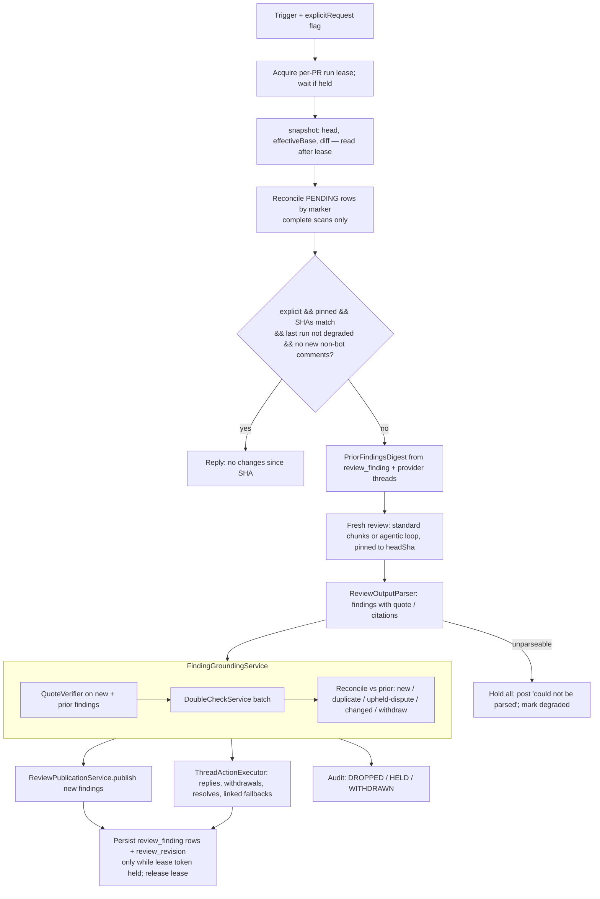
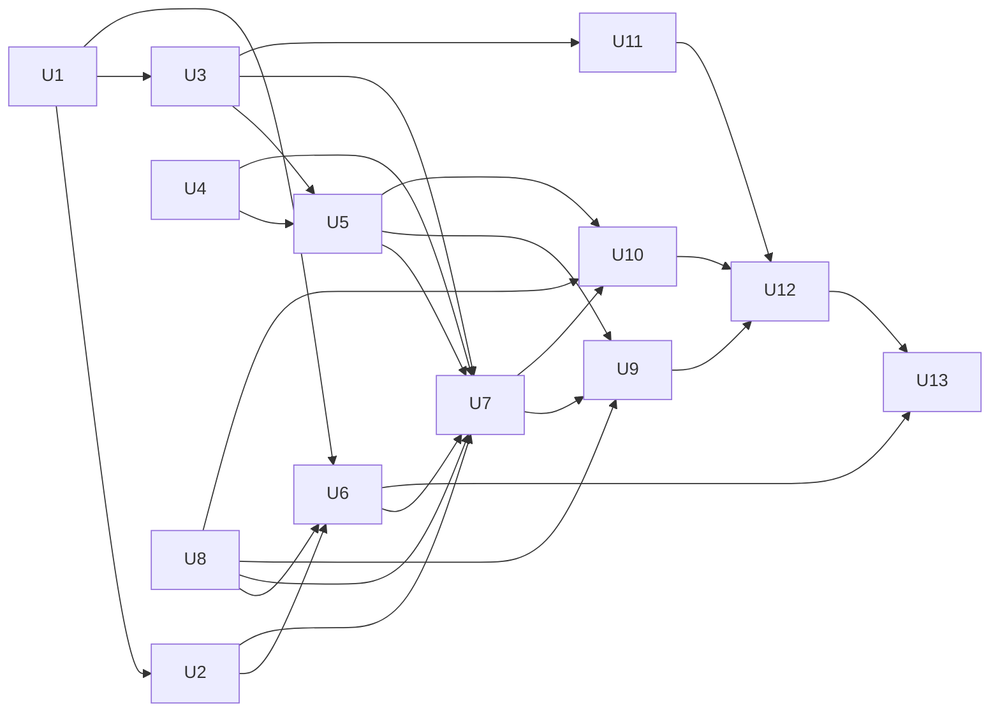

# feat: Grounded re-reviews

## Overview

Repeat reviews currently replay the stored chat transcript (including the bot's own prior rendered reviews) and
nothing verifies that a finding's cited code exists. On Gitea PR `bc3tech/sessionregistry#66` this produced the same
fabricated `force_args` BLOCKER three times, plus a "bug" that described the PR's own fix.

This plan makes every review fresh, requires each finding to carry a structured quote, verifies quotes
deterministically against the pinned revision, runs a configurable AI double-check, tracks posted findings across
runs (dedup, disputes, withdrawal), skips explicit re-reviews of unchanged revisions, and audits every dropped or
held finding. It applies to both the standard (`CodeReviewService`) and agentic (`AgentReviewService`) paths.

Requirements R1–R16 are defined in the origin document and referenced by ID throughout.

## Problem Frame

See origin. Root cause (confirmed in code): `CodeReviewService.runReview` branches on session emptiness; a non-empty
session goes through `buildPrUpdateMessage` + `aiClient.chat(sessionService.toAiMessages(session), …)`, which replays
prior rendered reviews. There is no grounding step between `ReviewOutputParser.parse` and
`ReviewPublicationService.publish` on either path.

## Requirements Trace

| Req | Units |
|---|---|
| R1 fresh review | U9, U10 |
| R2 prior-findings digest | U3, U5, U9, U10 |
| R3 structured quote | U1 |
| R4 deterministic quote check | U2, U7 |
| R5 review-wide citations | U1, U2, U7 |
| R6 double-check pass | U6, U7, U13 |
| R7 per-bot double-check config | U6 |
| R8 double-check failure degrade | U7 |
| R9 duplicate suppression | U3, U7 |
| R10 disputes | U4, U5, U7 |
| R10a withdrawal | U4, U7 |
| R10b linked-comment fallback | U4, U7 |
| R11 re-post on changed code | U7 |
| R12 unchanged-revision skip | U3, U11 |
| R10a/R10b thread actions on GitHub | U4 (GraphQL resolve) |
| R13 per-finding audit | U8 |
| R14 both paths | U9, U10, U12 |
| R15 revision pinning | U2, U9, U10 |
| R16 no-SHA fallback | U2, U7, U11 |

## Context & Research

### Relevant code and patterns

- **Shared pipeline:** both paths call `ReviewPublicationService.snapshot` → `ReviewOutputParser.parse` →
  `ReviewPublicationService.publish`. The grounding step slots between parse and publish on both.
- **Snapshot:** `ReviewSnapshot` (head/base/start SHAs + diff). Gitea (`GiteaInlineReviewPublisher.snapshot`) carries
  merge-base; GitLab carries `start_commit_sha` from MR versions; GitHub carries `base.sha` (target branch tip);
  Bitbucket and failed/unstable snapshots fall back to `ReviewSnapshot.summaryOnly(diff)` with null SHAs.
- **Pinned reads:** `RepositoryApiClient.getFileContent(owner, repo, path, ref)` already accepts a SHA.
  `PrContextEnricher` and `AgentReviewService.prepareWorkspace` currently pass a branch name (R15 gap).
- **Finding model:** `ReviewDocument.Finding(id, body, path, side, line, severity, category)`;
  `ReviewOutputInstructions` (shared ENVELOPE spec); `ReviewOutputParser.toFinding`.
- **Publication result:** `ReviewPublicationResult` holds `CommentOutcome(comment, delivery, remoteId)` — the source
  of posted-finding remote IDs.
- **Per-bot settings:** workflow parameter enums (`ReviewParam` + `ReviewWorkflow.paramsSchema()`,
  `AgentReviewParam` + `AgentReviewWorkflow`) resolved via `selectionService.resolveParams`. No migration needed.
- **AI clients:** `AiClientFactory.getClient(AiIntegration)`; one model per integration, wrapped in
  `AuditingAiClient(RetryAiClient(...))`.
- **Audit:** `AuditEventType` (string-persisted enum; `FINDING_SUPPRESSED` is `@Deprecated`), `PrAuditEvent`
  (hash-chained, `eventPayloadJson`), `PrAuditEventService.record`, `AuditLogGarbageCollector` (`audit.retention`
  default `P90D`). Only `PrWorkflowOrchestrator` emits `FINDING_POSTED`, once per review.
- **Triggers:** `BotWebhookService.reviewOnRequest` (comment commands, `triggerCommentId != null`) and
  `action == "review_requested"` distinguish explicit requests; nothing propagates this to workflows yet.
- **Migrations:** paired PostgreSQL + H2 under `src/main/resources/db/migration/{postgresql,h2}/`; latest is
  `V57__drop_bot_type.sql`.
- **Tests:** JUnit 5 + Mockito + AssertJ, `MockRestServiceServer` for provider clients, H2, ArchUnit
  (`ArchitectureTest`: no field injection, package rules).

### Institutional learnings

- `docs/plans/2026-10-06-001-feat-inline-review-comments-plan.md`: Bitbucket Cloud lacks revision binding (summary
  fallback); Gitea 28 placement is best-effort and verified; GitLab publishes one discussion per finding;
  cross-run dedup and per-finding audit were explicitly deferred to this work.
- No `docs/solutions/` entries exist.

### External references (verify during implementation)

- GitHub: reply via `POST /repos/{o}/{r}/pulls/{pr}/comments/{id}/replies`; edit via
  `PATCH /repos/{o}/{r}/pulls/comments/{id}`; resolve only via GraphQL `resolveReviewThread`.
- GitLab: reply via `POST .../merge_requests/{iid}/discussions/{discussion_id}/notes`; resolve via
  `PUT .../discussions/{discussion_id}` with JSON body `{"resolved": true}`; edit via `PUT .../notes/{note_id}`.
- Gitea: review comments are readable via `GET .../pulls/{pr}/reviews/{id}/comments`; no documented API to reply into
  an existing review thread or resolve a conversation (web-UI only). Edit of review comments via API is unverified.
- Bitbucket: comment replies via `parent.id` on `POST .../pullrequests/{id}/comments`; edit via `PUT`; resolve via
  `POST .../comments/{id}/resolve` (verify on Cloud).

## Key Technical Decisions

- **KTD1 — Prior findings come from the bot's own store, replies from the provider.** A new `review_finding` table
  records every finding the bot published (inline or summary-only) with quote, location, context hash, revision,
  severity, marker, and provider remote ID (when one exists). Replies/disputes are read live from provider comments and
  joined by remote/thread ID or marker. Held findings are **not** stored here (audit only, KTD10); held-ness is tracked
  as a `degraded` flag on the revision record (KTD6). Rationale: session text is rewritten by `compactContextWindow`,
  and provider comment bodies are rendered markdown that is lossy to parse.
- **KTD2 — Issue identity separate from evidence identity.** Evidence fingerprint = `(path, side, normalized quote
  hash)`. Issue identity = evidence fingerprint + `category` + `contextHash` (hash of the ±5 normalized lines around the
  matched quote at the reviewed revision). R9 duplicate = same issue identity **and** same `contextHash` at the new
  revision. Same quote with a different category is a distinct finding (both survive). Renames: provider rename info
  from the diff (`rename from/to`) maps old path → new path before matching. A prior whose quote still resolves but
  whose `contextHash` changed is "context changed" → re-double-checked (KTD13), not auto-suppressed. A prior whose
  quote no longer resolves (beyond the anchor-relocation search in KTD3) is "code changed" (R11) or "gone" (R10a).
- **KTD3 — Quote match: literal content, indentation-tolerant, tight anchor binding.** Per line: strip leading and
  trailing whitespace only; internal whitespace (including inside string literals) is compared literally. Quote must
  be a contiguous run of such lines. **Strength:** every quote (anchored or citation) needs ≥ 1 line with ≥ 8
  non-whitespace chars. **Anchored:** the matched span must contain the anchor line or end within ±3 lines of it on the
  indicated side (`RIGHT` → head, `LEFT` → effective base). If the quote occurs more than once within ±10 lines of the
  anchor, the finding fails as ambiguous. A quote that matches only elsewhere in the file fails (R4 "misattributed").
  For priors only, a relocation search over the whole file is allowed when exactly one occurrence exists (handles
  large line shifts). **Citations (R5):** must match exactly one occurrence in the cited file (or be ambiguous → fail).
- **KTD4 — Batched double-check with a richer evidence package and a three-way verdict.** One structured prompt lists
  candidate findings, each with: quote context (±15 lines of pinned code), the relevant diff hunk, any supporting
  citations, a list of all changed files with short hunk headers (so cross-file refutation is possible), and dispute
  text. Verdict per finding: `keep | drop | uncertain` + reason. `uncertain` → held (audited) — the goal is fewer false
  positives. Candidate IDs are assigned **after** chunk merge (globally unique); duplicate or conflicting verdicts for
  one ID are treated as failure for that finding. Chunk by the bot's configured budget (reuse `CodeReviewService`
  chunk params); a single finding that alone exceeds the budget has its context trimmed to ±5 lines, and if still too
  big is held. Missing verdict = call failure for that finding (R8 rules). With no pinned revision (R16) the input is
  diff hunks only, and the prompt says so.
- **KTD5 — Double-check settings are workflow params; model is an optional second AI integration by ID.** New params
  on both `ReviewParam` and `AgentReviewParam`: `DOUBLE_CHECK_ENABLED` (boolean, default true),
  `DOUBLE_CHECK_MIN_SEVERITY` (enum, default lowest), `DOUBLE_CHECK_AI_INTEGRATION_ID` (int; blank/0 = same integration
  as the review). Resolve via `AiIntegrationService.findById` → `AiClientFactory.getClient`. Missing ID → fall back to
  the review integration and record a warning audit event. No Bot entity migration.
- **KTD6 — Revision state in a `review_revision` table keyed by (bot, owner, repo, pr, workflowKey).** Stores last
  reviewed `headSha`, `effectiveBaseSha`, `reviewedAt`, `degraded` (true when the run held findings because of
  double-check failure/uncertain, produced unparseable output, or ran unpinned), a comment cursor
  (`lastSeenCommentAt` + `lastSeenCommentId` of the latest non-bot comment observed by the run; a comment counts as
  new if its timestamp is later, or equal with an unseen ID; missing timestamps count as new). Updated only after successful publish and only while the run holds the lease
  (KTD12). Force-push: a new head SHA is a new revision; priors resolve via KTD2/KTD3, so no special branch is needed.
- **KTD7 — Effective diff base normalization.** Add `effectiveBaseSha()` to `ReviewSnapshot`: Gitea → merge-base,
  GitLab → `start_sha`, GitHub → compute via `GET /repos/{o}/{r}/compare/{base}...{head}` `merge_base_commit.sha`
  inside `GitHubApiClient.getReviewSnapshot`; null when unavailable. A snapshot is **pinned** only when both head and
  effective base are non-null; otherwise R16 applies (no R12 skip, summary-only, KTD14).
- **KTD8 — Provider thread operations behind capability flags.** Add to `RepositoryApiClient` default methods
  `threadCapabilities()` (`canReplyInThread`, `canEditComment`, `canResolveThread`), `replyToReviewThread`,
  `editReviewComment`, `resolveReviewThread`, all defaulting to unsupported. `ReviewComment` gains `threadId`,
  `parentId`, `createdAt`, `resolved`. Callers fall back to a linked PR comment (R10b). GitHub resolve is implemented
  via GraphQL `resolveReviewThread` (thread node ID looked up via GraphQL `pullRequest.reviewThreads`); on auth/scope
  failure the client marks resolve unsupported for that run and falls back to reply-only. The GraphQL endpoint is
  derived separately from the REST base: github.com → `https://api.github.com/graphql`; Enterprise (REST base ending
  `/api/v3`) → same host `/api/graphql`.
- **KTD9 — Dispute association is explicit-first; dispute replies are remembered.** Association order: (1) reply in the
  finding's thread; (2) PR-level comment containing the finding's marker (`<!-- aigb:finding:<uuid> -->`, embedded in
  each published finding and in linked-fallback comments) or linking its remote comment URL; (3) PR-level comment
  quoting a normalized quote line **only if** that line matches exactly one active finding. Bot's own comments are
  excluded by login. Any associated non-bot text is passed to the double-check as a claim (R6); the double-check, not
  the association step, decides whether it is a substantive dispute. Each run stores the ID of the latest non-bot
  comment it answered per finding (`lastAnsweredCommentId`); an upheld reply is posted only when newer non-bot text
  exists. Truncation keeps the first and the latest non-bot replies and drops the middle.
- **KTD10 — New audit types, not the deprecated one.** Add `FINDING_DROPPED`, `FINDING_HELD`, `FINDING_WITHDRAWN`,
  `GROUNDING_WARNING` (config fallback, unparseable output, stale-run abort). Payload: `{findingId, path, side, line,
  quoteHash, quotePreview(≤200 chars), severity, category, stage, reason, headSha, effectiveBaseSha}`. Leave
  `FINDING_SUPPRESSED` deprecated. Keep default 90-day audit retention (operational state has its own lifecycle,
  KTD15).
- **KTD11 — Standard path keeps appending to the session for chat, but never reads it for reviews.** `runReview`
  always takes the chunked fresh path; the rendered review is still appended so @mention chat retains context
  (scope boundary: chat path unchanged).
- **KTD12 — Per-PR run lease (serialized runs).** Review runs for a PR (bot, owner, repo, pr) are serialized by a
  database lease: columns `leaseOwner`, `leaseToken` (monotonic), `leaseExpiresAt` on a `review_run_lease` row,
  acquired by a conditional update (free or expired). The holder renews it on a heartbeat (TTL default 10 min,
  `review-state.lease-ttl`) and releases it in `finally`. A newer trigger waits in its async worker (poll with backoff,
  bounded by `review-state.lease-wait-max`, default 30 min; on timeout it posts the existing "couldn't complete"
  failure comment and clears 👀), and after acquiring **re-reads the snapshot**, so it reviews the latest head. Its
  explicit-request skip check (U11) then runs against state written by the previous run. The `leaseToken` is a
  fencing token: before every provider mutation and state write the run confirms it still holds the token; a run whose
  lease expired (stalled process) aborts with `GROUNDING_WARNING: lease lost`. Because only one run is live at a time,
  PENDING reconciliation (KTD13) never races another run's in-flight write; the remaining window (a write landing just
  after the lease expires) is handled by KTD13's next-run reconciliation. Rejected: optimistic latest-wins (TOCTOU
  between check and remote write) and a trigger queue (more moving parts for the same guarantee).
- **KTD13 — Write-ahead finding records and marker reconciliation.** Before publishing, each finding is written as
  `PENDING` with its marker. After provider success it becomes `PUBLISHED` with remote ID. At the start of each run,
  `PENDING` rows are reconciled by scanning the bot's own PR/review comments for markers: found → `PUBLISHED` (adopt
  remote ID); not found → discarded. Scans must be **complete**: every page of issue/PR comments, inline review
  comments, and review bodies (where the provider stores them separately). A scan that errors or cannot exhaust
  pagination is *inconclusive* — affected rows are left unchanged and retried next run; absence is only trusted from
  a complete scan. Stored `PUBLISHED` rows whose remote comment no longer exists → `GONE` (excluded
  from withdrawals; still used for dedup so a human-deleted finding is not re-posted unless its context changed).
  Withdrawal: row becomes `WITHDRAWN` only after the reply/linked comment succeeds; failures leave it active for retry.
  Thread comments are re-read immediately before resolve; resolve is skipped if new non-bot text appeared.
  **Prior re-evaluation:** every active prior that is disputed **or** whose `contextHash` changed is included in the
  double-check; priors with unchanged context and no dispute are kept as-is.
- **KTD14 — Fail-closed evidence policy.**
  - Unparseable / non-envelope model output is never published as review text. The run publishes a short summary
    ("review output could not be parsed; no findings posted"), audits `GROUNDING_WARNING`, and marks the revision
    `degraded`.
  - Unpinned (R16): quotes are verified against the diff text for the cited file (added + context lines for `RIGHT`,
    removed + context for `LEFT`) using KTD3 rules minus anchor binding; failures are dropped. Survivors are
    double-checked with diff-only input and published summary-only. Priors are never quote-rechecked,
    re-double-checked, withdrawn, or thread-actioned while unpinned; new findings are still deduped against priors.
    PENDING marker reconciliation (KTD13) still runs because it depends only on the bot's own comments, not code.
- **KTD15 — Operational state lifecycle.** `review_finding` and `review_revision` rows are deleted 30 days after the PR
  is closed/merged (new scheduled job alongside `AuditLogGarbageCollector`, property `review-state.retention-after-close`
  default `P30D`). Not tied to audit retention. Reopen clears `prClosedAt`; the collector re-checks that the PR is
  still closed (provider read) before deleting, and skips on read failure.
- **KTD16 — Summary-only findings are tracked by marker.** Summary-only findings (review-wide, unanchored, or
  unpinned) are persisted with their marker and the summary comment's remote ID when the provider returns one
  (new distinctly named variants such as `postReviewReturningId` return an optional remote ID; the existing `void`
  methods delegate to them).
  They participate in dedup and dispute association via marker. Upheld replies and withdrawals for them are always
  linked PR comments; the shared summary comment is never edited.

## Open Questions

### Resolved during planning
- Prior-findings source → KTD1. Same-location matching → KTD2. Quote strictness → KTD3. Batching → KTD4. Settings
  location → KTD5. Revision storage + force-push → KTD6. Effective base → KTD7. Provider capabilities → KTD8.
  Dispute definition → KTD9. Audit contract + retention → KTD10, KTD15. Concurrency → KTD12. Crash/partial-failure
  recovery → KTD13. Unparseable output and unpinned evidence → KTD14. Summary-only identity → KTD16. Agentic history:
  already fresh per run (`new AgentSession(...)` each run); only R2 digest injection, R15 pinning, and grounding are
  needed (U10).

### Deferred to implementation
- Exact Gitea capability for editing review comments via API (U4 probe on Gitea 28; fall back to reply-only).
- Bitbucket Cloud resolve endpoint availability (U4; flag off if unverifiable).
- Whether the double-check prompt fits typical reviews without chunking (measure in U12).

## High-Level Technical Design

> *This illustrates the intended approach and is directional guidance for review, not implementation
> specification. The implementing agent should treat it as context, not code to reproduce.*



Grounding output (directional):

```
GroundingResult {
  publish: List<Finding>            // to ReviewPublicationService
  summaryNotes: List<String>        // e.g. "double-check unavailable", "findings could not be anchored"
  threadActions: List<ThreadAction> // UpheldReply | Withdraw(reason) per prior finding
  audit: List<FindingDisposition>   // dropped / held / withdrawn with stage + reason
}
```

## Implementation Units

### Phase A — Foundations

- [x] **U1. Finding evidence schema**
  - **Goal:** Findings carry a structured `quote` (line-anchored) or `citations` (review-wide). (R3, R5)
  - **Requirements:** R3, R5
  - **Dependencies:** none
  - **Files:**
    - Modify `src/main/java/org/remus/giteabot/review/ReviewDocument.java` (add `quote`, `List<Citation> citations`,
      nested `Citation(path, quote)`; update `dedupKey`)
    - Modify `src/main/java/org/remus/giteabot/review/ReviewOutputInstructions.java` (ENVELOPE: require `quote` for
      anchored findings, `citations` for review-wide; quote must be verbatim current code)
    - Modify `src/main/java/org/remus/giteabot/review/ReviewOutputParser.java` (`toFinding` parses both; `merge`
      preserves them)
    - Test `src/test/java/org/remus/giteabot/review/ReviewOutputParserTest.java`
  - **Approach:** Additive record fields with null defaults; keep existing constructors via compact canonical
    overloads where used by tests. Non-envelope (unstructured) output is flagged `structured=false`; per KTD14 it is
    never published as review text (handled in U7).
  - **Test scenarios:**
    - Happy: envelope with `quote` on anchored finding → parsed into field.
    - Happy: review-wide finding with two citations → both parsed.
    - Edge: missing `quote` → field null (rejection happens in U2/U7, not parser).
    - Edge: multi-line quote with `\n` preserved.
    - Regression: existing envelope fixtures without quotes still parse.
  - **Verification:** `ReviewOutputParserTest` passes; `ReviewOutputInstructions` text includes quote contract.

- [x] **U2. Pinned source reader + QuoteVerifier**
  - **Goal:** Deterministic quote check against the pinned revision. (R4, R5, R15)
  - **Requirements:** R4, R5, R15
  - **Dependencies:** U1
  - **Files:**
    - Create `src/main/java/org/remus/giteabot/review/grounding/PinnedSourceReader.java` (per-run cache of
      `getFileContent(owner, repo, path, sha)`; throws on unreadable revision)
    - Create `src/main/java/org/remus/giteabot/review/grounding/QuoteVerifier.java`
    - Create `src/main/java/org/remus/giteabot/review/grounding/QuoteMatch.java` (result: matched, matchedSpan,
      contextHash, failureReason)
    - Create `src/main/java/org/remus/giteabot/review/grounding/DiffTextSource.java` (unpinned mode: per-file
      added/removed/context lines from the diff, KTD14)
    - Test `src/test/java/org/remus/giteabot/review/grounding/QuoteVerifierTest.java`
  - **Approach:** KTD3 rules. `RIGHT` side reads `headSha`; `LEFT` reads `effectiveBaseSha` (never substitute
    `baseSha`; a snapshot is "pinned" only when both head and effective base are present). Computes `contextHash`
    (±5 normalized lines) for KTD2. Relocation search for priors only. Unpinned mode verifies against `DiffTextSource`
    without anchor binding. Deleted/binary files fail with reason. Reader never accepts a branch name.
  - **Test scenarios:**
    - Happy: exact quote at anchor line → match.
    - Happy: quote with different leading indentation → match.
    - Error: quote differing only in internal whitespace inside a string literal (`"a b"` vs `"a  b"`) → fail.
    - Happy: multi-line quote spanning anchor → match.
    - Error: quote absent from file (PR 66 `force_args=($RELEASE_FORCE)`) → fail `QUOTE_NOT_FOUND`.
    - Error: quote matches 6 lines from anchor → fail `QUOTE_OUT_OF_WINDOW`.
    - Error: same line appears twice within ±10 of anchor → fail `QUOTE_AMBIGUOUS`.
    - Error: empty/blank quote → fail `QUOTE_MISSING`.
    - Edge: anchored or citation quote too weak (`}`) → fail `QUOTE_TOO_WEAK`.
    - Edge: LEFT-side finding resolves against effective base revision.
    - Edge: prior relocation — unique quote shifted 50 lines → match; duplicated quote → fail.
    - Edge: unpinned mode — quote in diff added lines → match; quote not in diff → fail.
    - Error: file unreadable at SHA → `RevisionUnavailableException`.
  - **Verification:** unit tests green; no call path passes a branch ref (assert in test via mock verify).

- [x] **U3. Review state persistence, run lease, and lifecycle**
  - **Goal:** Persist published findings and last-reviewed revisions; provide the per-PR run lease and operational
    retention. (R2, R9, R11, R12; KTD1, KTD6, KTD12, KTD13, KTD15, KTD16)
  - **Requirements:** R2, R9, R11, R12
  - **Dependencies:** U1
  - **Files:**
    - Create `src/main/resources/db/migration/postgresql/V58__review_grounding_state.sql`
    - Create `src/main/resources/db/migration/h2/V58__review_grounding_state.sql`
    - Create `src/main/java/org/remus/giteabot/review/state/ReviewFindingRecord.java` (entity: id UUID, marker, botId,
      owner, repo, pr, workflowKey, path, side, line, quote, quoteHash, contextHash, severity, category, body, status
      [PENDING|PUBLISHED|WITHDRAWN|SUPERSEDED|GONE], summaryOnly, remoteCommentId, remoteThreadId,
      lastAnsweredCommentId, headSha, createdAt, updatedAt)
    - Create `src/main/java/org/remus/giteabot/review/state/ReviewRevisionRecord.java` (botId, owner, repo, pr,
      workflowKey, headSha, effectiveBaseSha, reviewedAt, degraded, lastSeenCommentAt, lastSeenCommentId,
      prClosedAt; unique key)
    - Create `src/main/java/org/remus/giteabot/review/state/ReviewRunLease.java` (botId, owner, repo, pr unique;
      leaseOwner, leaseToken, leaseExpiresAt) and `ReviewRunLeaseService.java` (`acquire` with bounded wait,
      `renew` heartbeat, `assertHeld(token)`, `release`; conditional-update acquisition)
    - Create repositories + `src/main/java/org/remus/giteabot/review/state/ReviewStateService.java`
      (`recordPending`, `markPublished`, `markWithdrawn`, `activeFindings`, `upsertRevision`; writes take the lease
      token and call `assertHeld`)
    - Create `src/main/java/org/remus/giteabot/review/state/ReviewStateGarbageCollector.java`
      (`review-state.retention-after-close`, default `P30D`)
    - Modify PR-closed handling in `admin/BotWebhookService` to stamp `prClosedAt` (do not delete state); clear it
      on reopen
    - Test `src/test/java/org/remus/giteabot/review/state/ReviewStateServiceTest.java`,
      `ReviewRunLeaseServiceTest.java`, `ReviewStateGarbageCollectorTest.java`
  - **Approach:** Constructor injection (ArchUnit). Index on (botId, owner, repo, pr, workflowKey, status). Held
    findings are never stored (audit only). Revision row upserted only after successful publish **and** only while
    the lease token is held. Lease waiting happens in the async workflow worker, never on the webhook request thread.
  - **Test scenarios:**
    - Happy: pending → published with remote ID → retrievable as active prior.
    - Happy: upsert revision updates head/base/degraded/comment cursor.
    - Happy: second `acquire` on the same PR waits until the first `release`, then gets a higher token.
    - Edge: two concurrent `acquire` calls → exactly one holder; the other waits.
    - Edge: holder stops heartbeating → lease expires → waiter acquires; stale holder's `assertHeld` fails and its
      state writes are rejected.
    - Error: wait exceeds `lease-wait-max` → acquire returns timeout (caller posts failure comment).
    - Edge: lease always released when the run throws.
    - Edge: two workflows on same PR keep separate state.
    - Edge: withdrawn/GONE findings excluded from withdrawal set; GONE still visible to dedup.
    - Edge: GC deletes rows only for PRs closed > 30 days; open PRs never collected.
    - Edge: close → reopen → 30 days elapse → state retained; provider says open at GC time → retained.
    - Edge: PENDING row with inconclusive scan → left PENDING, not discarded.
    - Integration: migration applies on H2 test profile.
  - **Verification:** H2 boots with V58; service and GC tests green.

- [x] **U4. Provider thread capabilities and comment identity**
  - **Goal:** Read thread identity/replies; reply, edit, resolve where supported; return remote IDs for summary
    posts; linked fallback otherwise. (R10, R10a, R10b; KTD8, KTD16)
  - **Requirements:** R10, R10a, R10b
  - **Dependencies:** none
  - **Files:**
    - Modify `src/main/java/org/remus/giteabot/repository/model/ReviewComment.java` (threadId, parentId,
      createdAt, resolved)
    - Create `src/main/java/org/remus/giteabot/repository/model/ThreadCapabilities.java`
    - Modify `src/main/java/org/remus/giteabot/repository/RepositoryApiClient.java` (defaults:
      `threadCapabilities()`, `listReviewThreadComments(owner, repo, pr)`, `listPullRequestComments(owner, repo, pr)`,
      `replyToReviewThread`, `editReviewComment`, `resolveReviewThread`, `pullRequestCommentLink(remoteId)`;
      add distinctly named `Optional<String>`-returning variants — e.g. `postReviewReturningId`,
      `postReviewCommentReturningId`, `postPullRequestCommentReturningId` — with the existing `void` methods
      delegating, so third-party/test clients keep compiling; listing methods exhaust pagination and report whether
      the scan completed)
    - Modify `github/GitHubApiClient.java` (reply + edit via REST; resolve via GraphQL `reviewThreads` lookup +
      `resolveReviewThread` mutation, downgrade capability on auth/scope error), `gitlab/GitLabApiClient.java` (reply,
      edit, resolve via discussions with JSON body), `gitea/GiteaApiClient.java` (read threads; edit if probe
      confirms; reply/resolve unsupported), `bitbucket/BitbucketApiClient.java` (reply via parent, edit; resolve if
      verified)
    - Tests: `GitHubApiClientTest`, `GitLabApiClientTest`, `GiteaApiClientTest`, `BitbucketApiClientTest`
  - **Approach:** Default methods throw `UnsupportedOperationException`; callers check `threadCapabilities()` first.
    Thread ID mapping: GitHub `in_reply_to_id` root (plus GraphQL thread node ID for resolve), GitLab discussion ID,
    Gitea review ID + path + line (best-effort), Bitbucket parent chain root. GitHub GraphQL uses a `RestClient`
    built from the derived GraphQL endpoint (KTD8; Enterprise `/api/graphql`, not under `/api/v3`), no new library.
  - **Execution note:** Probe Gitea 28 (`tea api --login bc3tech`) for review-comment edit before implementing.
  - **Test scenarios:**
    - Happy (per provider): reply posts to correct endpoint/body (`MockRestServiceServer`).
    - Happy: GitLab resolve sends PUT with body `{"resolved": true}`.
    - Happy: GitHub resolve looks up thread node ID and sends `resolveReviewThread` mutation.
    - Error: GitHub GraphQL returns FORBIDDEN → capability downgraded, no exception to caller.
    - Happy: GitHub Enterprise base `https://ghe.example/api/v3` → GraphQL posts to `https://ghe.example/api/graphql`.
    - Happy (per provider): comment listing follows all pages (2+ pages fixture) and reports complete.
    - Error: page 2 fails → listing reports incomplete, no partial "complete" result.
    - Happy: thread listing maps parent/thread IDs, author login, createdAt.
    - Happy: `postReviewComment` variant returns remote ID where provider supplies one.
    - Error: unsupported op on Gitea → capability false, no HTTP call.
    - Error: 404 on reply → surfaced as recoverable failure (caller falls back).
  - **Verification:** provider client tests green; capability matrix documented in Javadoc.

### Phase B — Grounding core

- [x] **U8. Per-finding audit events**
  - **Goal:** Record dropped/held/withdrawn findings and grounding warnings with reasons. (R13; KTD10)
  - **Requirements:** R13
  - **Dependencies:** none (defines the disposition audit contract U7 records against)
  - **Files:**
    - Modify `src/main/java/org/remus/giteabot/audit/AuditEventType.java` (add `FINDING_DROPPED`, `FINDING_HELD`,
      `FINDING_WITHDRAWN`, `GROUNDING_WARNING`)
    - Modify `src/main/java/org/remus/giteabot/audit/PrAuditEventService.java` (add `recordFindingDisposition`,
      `recordGroundingWarning`)
    - Check migrations for any check constraint on the event type column; add V59 pair only if needed
    - Test `src/test/java/org/remus/giteabot/audit/PrAuditEventServiceTest.java`
  - **Approach:** KTD10 payload via existing `toJson(Map)`; requires `runId` — passed into standard path in U9.
    Quote preview truncated to 200 chars.
  - **Test scenarios:**
    - Happy: each disposition type → event with expected payload keys.
    - Happy: grounding warning (config fallback, unparseable output, lease lost) → event with reason.
    - Edge: hash chain remains valid across multiple per-finding events in one run.
    - Edge: very long quote → preview truncated, hash recorded.
  - **Verification:** audit tests green; events visible in existing run audit view.

- [x] **U5. Prior-findings digest and dispute association**
  - **Goal:** Reconcile pending records, build the R2 digest, and associate replies with prior findings. (R2, R10;
    KTD9, KTD13)
  - **Requirements:** R2, R10
  - **Dependencies:** U3, U4
  - **Files:**
    - Create `src/main/java/org/remus/giteabot/review/grounding/PriorFindingsDigest.java`
    - Create `src/main/java/org/remus/giteabot/review/grounding/PriorFindingsService.java`
    - Test `src/test/java/org/remus/giteabot/review/grounding/PriorFindingsServiceTest.java`
  - **Approach:** (pinned runs only) reconcile `PENDING` rows by scanning bot comments for markers; mark rows whose
    remote comment vanished as `GONE`. Load active records; fetch thread + PR-level comments; associate non-bot text per
    KTD9 order (thread → marker/link → unique quote line). Flag a prior "has new dispute text" only when non-bot text
    newer than `lastAnsweredCommentId` exists. Render a labeled prompt block ("History to evaluate — NOT current
    code") with location, quote, severity, revision, replies. Truncation keeps first and latest non-bot replies.
  - **Test scenarios:**
    - Happy: thread reply by author → associated with reply text.
    - Happy: PR-level comment containing finding marker → associated.
    - Happy: PR-level comment quoting a line unique to one finding → associated.
    - Edge: PR-level comment quoting a line shared by two findings → not associated by quote.
    - Edge: bot's own replies ignored.
    - Edge: dispute already answered (no newer non-bot text) → not flagged new.
    - Edge: long thread → first and latest replies kept, middle elided.
    - Edge: PENDING row with marker found on provider → PUBLISHED with remote ID; not found → discarded.
    - Edge: published row whose comment was deleted → GONE.
    - Edge: no prior findings → empty digest, no prompt block.
  - **Verification:** rendered digest text matches snapshot; association tests green.

- [x] **U6. Double-check service and per-bot settings**
  - **Goal:** Batched AI keep/drop/uncertain pass with per-bot config. (R6, R7; KTD4, KTD5)
  - **Requirements:** R6, R7
  - **Dependencies:** U1, U2, U8
  - **Files:**
    - Create `src/main/java/org/remus/giteabot/review/grounding/DoubleCheckService.java`
    - Create `src/main/java/org/remus/giteabot/review/grounding/DoubleCheckSettings.java`
    - Create `src/main/resources/prompts/double-check.md` (or alongside existing prompt resources)
    - Modify `ReviewParam` / `ReviewWorkflow.paramsSchema()` and `AgentReviewParam` / `AgentReviewWorkflow`
      (`DOUBLE_CHECK_ENABLED`, `DOUBLE_CHECK_MIN_SEVERITY`, `DOUBLE_CHECK_AI_INTEGRATION_ID`)
    - Modify `CodeReviewServiceFactory.create(...)` to pass settings
    - Test `src/test/java/org/remus/giteabot/review/grounding/DoubleCheckServiceTest.java`
  - **Approach:** KTD4/KTD5. Evidence package per finding: id (assigned post-merge), severity, category, body, quote,
    ±15 lines of pinned code (diff-only when unpinned), diff hunk, supporting citations, dispute text; plus a
    changed-files list with hunk headers for the whole batch. Instructions: drop non-defects and descriptions of
    intended fixes; treat replies as claims to verify; answer `uncertain` when the evidence package cannot decide.
    Output JSON parsed strictly; unknown/missing/duplicate IDs → per-finding failure. Selection: new findings ≥ min
    severity when enabled; plus all priors with new dispute text or changed `contextHash`, always (R7, KTD13).
  - **Test scenarios:**
    - Happy: model returns keep/drop/uncertain → mapped per finding; uncertain → held.
    - Happy: disabled + disputed finding → still checked; non-disputed → skipped.
    - Happy: min severity HIGH → MEDIUM finding skipped, published after quote check.
    - Happy: prior with changed context, no dispute → included.
    - Error: AI call throws → `DoubleCheckOutcome.failed()` for all.
    - Error: malformed JSON / missing ID / two verdicts for one ID → failure for affected findings only.
    - Edge: single oversized finding → context trimmed to ±5; still oversized → held.
    - Edge: integration ID blank → review's client; valid ID → resolved via `AiIntegrationService.findById`; unknown
      ID → review's client + `GROUNDING_WARNING`.
  - **Verification:** unit tests green; params render on bot workflow config form.

- [x] **U7. FindingGroundingService and thread actions**
  - **Goal:** Orchestrate quote check → double-check → reconcile against prior findings; emit publish list,
    thread actions, summary notes, dispositions. (R4–R11, R16; KTD2, KTD13, KTD14, KTD16)
  - **Requirements:** R4, R5, R6, R8, R9, R10, R10a, R10b, R11, R16
  - **Dependencies:** U2, U3, U4, U5, U6, U8
  - **Files:**
    - Create `src/main/java/org/remus/giteabot/review/grounding/FindingGroundingService.java`
    - Create `src/main/java/org/remus/giteabot/review/grounding/GroundingResult.java`,
      `FindingDisposition.java`, `ThreadAction.java`
    - Create `src/main/java/org/remus/giteabot/review/grounding/ThreadActionExecutor.java`
    - Modify `src/main/java/org/remus/giteabot/review/ReviewPublicationService.java` (accept summary notes; embed
      finding marker in inline and summary findings; write `PENDING` before provider calls; return remote IDs per
      finding ID; never publish unstructured text; confirm lease token before each provider mutation)
    - Test `src/test/java/org/remus/giteabot/review/grounding/FindingGroundingServiceTest.java`,
      `ThreadActionExecutorTest.java`
  - **Approach:**
    0. If the parsed document is unstructured (KTD14): hold everything, summary = "review output could not be
       parsed; no findings posted", audit `GROUNDING_WARNING`, mark revision degraded. Stop.
    1. Quote-check new findings (pinned: `PinnedSourceReader`; unpinned: `DiffTextSource`); drop failures (audit
       `FINDING_DROPPED`, stage QUOTE).
    2. Pinned only: re-verify every active prior's quote at the new revision (with relocation search); failures →
       `Withdraw(quote gone)`; compute new `contextHash`.
    3. Double-check eligible new findings + (pinned only) priors with new dispute text or changed context.
    4. On double-check failure (R8): keep only BLOCKER new findings marked "not double-checked"; hold others
       (`FINDING_HELD`); still withdraw prior quote failures; no other prior actions; add summary note; mark degraded.
       `uncertain` verdicts → held, mark degraded.
    5. Reconcile new vs prior via KTD2: same issue identity + same `contextHash` → suppress duplicate
       (`FINDING_DROPPED`, stage DEDUP); prior with new dispute text upheld → `UpheldReply` (update
       `lastAnsweredCommentId`); prior dropped by double-check → `Withdraw(reason)`; prior context changed and issue
       re-raised → publish fresh (R11) and mark old SUPERSEDED; GONE priors suppress identical new findings but get no
       thread actions.
    6. R16 unpinned (head or effective base missing): verify via diff text, strip anchors (summary-only), still
       double-check with diff-only input, add "could not be anchored" note; skip steps 2 and all prior thread actions.
    7. `ThreadActionExecutor` (confirms lease token before each call): inline priors → reply in thread if capable, else
       linked PR comment with marker + link; summary-only priors → always linked PR comment; edit original to prefix
       "Withdrawn" if capable and not a shared summary comment; re-read thread right before resolve and skip if new
       non-bot text appeared; mark `WITHDRAWN` only after success, otherwise leave active for retry.
  - **Test scenarios:**
    - Happy: grounded new finding kept → in `publish`.
    - Error (PR 66): fabricated `force_args` quote → dropped, audited, not published.
    - Error (PR 66): finding describing 409 → 428 fix → double-check drop → not published.
    - Happy: duplicate of unchanged prior → suppressed.
    - Happy: two findings, same quote, different category → both kept.
    - Happy: disputed prior upheld, code unchanged → `UpheldReply` once; next run with no new reply → no reply.
    - Happy: disputed prior dropped → `Withdraw`; resolve skipped when human reply appeared just before resolve.
    - Happy: prior quote gone after push → `Withdraw(quote gone)` even when double-check fails.
    - Happy: guard added near unchanged quoted line → context changed → re-checked → dropped → withdrawn.
    - Happy: changed code, issue persists → fresh finding, prior SUPERSEDED.
    - Happy: file renamed, finding unchanged → suppressed as duplicate.
    - Error: double-check fails → only BLOCKERs published with marker; others HELD; summary note; degraded.
    - Error: unstructured model output → nothing published except parse-failure note; degraded.
    - Edge: R16 unpinned, fabricated quote not in diff → dropped; quote in diff → summary-only, double-checked.
    - Edge: R16 unpinned + double-check failure → only diff-verified BLOCKERs, summary-only.
    - Edge: withdrawal reply fails → finding stays active; next run retries.
    - Edge: lease lost mid-run (token no longer held) → no further provider mutations, no state writes.
    - Integration: Gitea capability set (no reply) → linked PR comment containing link + marker.
  - **Verification:** grounding tests green; `ReviewPublicationServiceTest` updated and green.
### Phase C — Path integration

- [x] **U9. Standard review: fresh, pinned, grounded**
  - **Goal:** Remove transcript replay; pin context reads; inject digest; wire grounding + state. (R1, R2, R14,
    R15)
  - **Requirements:** R1, R2, R14, R15
  - **Dependencies:** U5, U7, U8
  - **Files:**
    - Modify `src/main/java/org/remus/giteabot/review/CodeReviewService.java` (`runReview`: always chunked fresh
      path; delete/retire `buildPrUpdateMessage` review use; pass `snapshot.headSha()` to
      `gatherAdditionalContext`; insert digest into `buildUserMessage`; call grounding between `merge` and
      `publish`; keep session append for chat; accept `runId`)
    - Modify `PrContextEnricher` call site to accept SHA ref
    - Modify `CodeReviewServiceFactory` and the review workflow caller to pass `runId` and grounding deps
    - Test `src/test/java/org/remus/giteabot/review/CodeReviewServiceTest.java`
  - **Approach:** Acquire the per-PR run lease (U3) before reading the snapshot; release in `finally`. If the snapshot is pinned but a pinned read fails → stop
    the review (R15) and post the existing failure comment. If it is unpinned → R16 flow (KTD14).
  - **Test scenarios:**
    - Happy: non-empty session → `aiClient.chat` with history is NOT called; `submitReviewPrompt` is.
    - Happy: user message contains labeled digest when priors exist.
    - Happy: enricher receives head SHA, not branch.
    - Error: pinned read fails with SHAs present → review stops, failure reported.
    - Edge: chunked review → finding IDs unique after merge before grounding.
    - Integration: session still receives rendered review (chat continuity).
  - **Verification:** `CodeReviewServiceTest` green; grep confirms no review path calls `toAiMessages`.

- [x] **U10. Agentic review: pinned, grounded**
  - **Goal:** Pin workspace/tool reads to head SHA; inject digest; wire grounding. (R2, R14, R15)
  - **Requirements:** R2, R14, R15
  - **Dependencies:** U5, U7, U8
  - **Files:**
    - Modify `src/main/java/org/remus/giteabot/prworkflow/agentreview/AgentReviewService.java`
      (`prepareWorkspace` with `snapshot.headSha()` or verify checkout HEAD equals it; `AgentRunContext` ref = SHA;
      `buildKickoffMessage` appends digest; grounding between parse and publish; formal decision recomputed from
      grounded findings)
    - Modify `WorkspaceService.prepareWorkspace` to support checkout by SHA (fetch + detached checkout)
    - Modify `fetchFiles` tool ref source
    - Test `AgentReviewServiceTest.java`, `AgentReviewWorkflowTest.java`, workspace tests
  - **Approach:** Acquire the per-PR run lease (U3) before reading the snapshot; release in `finally`. Formal review action (`SeverityThresholds`) is computed
    after grounding so dropped findings don't drive REQUEST_CHANGES.
  - **Test scenarios:**
    - Happy: workspace prepared at head SHA.
    - Happy: dropped BLOCKER does not trigger REQUEST_CHANGES.
    - Happy: kickoff message includes digest.
    - Error: SHA checkout fails → review stops (R15).
  - **Verification:** agent review tests green.

- [x] **U11. Explicit-request flag and unchanged-revision skip**
  - **Goal:** Skip explicit re-reviews when head + effective base unchanged. (R12, R16)
  - **Requirements:** R12, R16
  - **Dependencies:** U3
  - **Files:**
    - Modify `src/main/java/org/remus/giteabot/admin/BotWebhookService.java` (set `explicitRequest` for comment
      commands and `review_requested`)
    - Modify `PrWorkflowContext` (or payload wrapper) to carry the flag
    - Modify `src/main/java/org/remus/giteabot/repository/model/ReviewSnapshot.java` (`effectiveBaseSha()`)
    - Modify `github/GitHubApiClient.getReviewSnapshot` (merge-base via compare API), Gitea/GitLab mapping
    - Modify review workflows to check `ReviewStateService` before running
    - Tests: `BotWebhookServiceTest`, `ReviewSnapshotTest`, `GitHubApiClientTest`, workflow tests
  - **Approach:** Skip only when ALL hold: flag set; snapshot pinned (both SHAs non-null); head and effective base
    equal stored; last revision record not `degraded`; no new non-bot PR/thread comment past the stored comment
    cursor (KTD6), determined from a complete scan (an inconclusive scan → full review).
    Otherwise run a normal review (which re-evaluates disputes and retries held findings). On skip, reply
    "No changes since last review at `<short-sha>`." and remove the 👀 reaction as other terminal paths do.
  - **Test scenarios:**
    - Happy: `/review` with same head + merge-base, clean last run, no new comments → reply, no AI call.
    - Happy: target branch pushed, merge-base unchanged → skip.
    - Happy: merge-base changed → full review.
    - Happy: same SHAs but author posted a new dispute comment → full review.
    - Happy: same SHAs but last run was degraded (double-check failed) → full review.
    - Edge: new comment with timestamp equal to the cursor but an unseen ID → full review.
    - Edge: comment scan fails → full review (never skip on missing evidence).
    - Edge: PR synchronize event (not explicit) with same SHAs → normal review path.
    - Edge: null SHAs → never skip.
  - **Verification:** tests green; skip path covered in both workflows.

### Phase D — Regression

- [ ] **U12. PR 66 replay regression set**
  - **Goal:** Labeled regression suite on both paths. (Success criteria, R14)
  - **Requirements:** R14, success criteria
  - **Dependencies:** U9, U10, U11
  - **Files:**
    - Create `src/test/resources/grounding/pr66/` (diffs per revision from session evidence, file contents per SHA,
      canned model outputs including fabricated `force_args` finding and 409→428 "bug")
    - Create `src/test/java/org/remus/giteabot/review/grounding/GroundedReReviewRegressionTest.java`
  - **Approach:** Fake `RepositoryApiClient` serving pinned files per SHA and recording posted comments; fake AI
    client returning canned review + double-check outputs. Parameterize over standard and agentic paths.
  - **Test scenarios:**
    - Sequence: initial → push → `/review` → push → `/review` → dispute → `/review`: no `force_args` finding
      published; no 409→428 finding published.
    - Absent quote → dropped. Misattributed quote → dropped. Intended-fix description → dropped. Valid finding →
      survives. Valid dispute → withdrawn. False dispute → upheld reply. Double-check failure → BLOCKER-only.
    - `/review` without changes → single "no changes" reply.
    - Every drop appears as an audit event with reason.
  - **Verification:** regression test green on both paths.

- [ ] **U13. Live double-check evaluation harness (opt-in)**
  - **Goal:** Measure whether the real double-check prompt and configured model actually make the right calls,
    which canned fakes cannot show. (Key decision: "regression set decides whether the default is good enough")
  - **Requirements:** R6 (verification of the default), success criteria
  - **Dependencies:** U6, U12
  - **Files:**
    - Create `src/test/java/org/remus/giteabot/review/grounding/DoubleCheckLiveEvalTest.java` (JUnit `@Tag("live-eval")`,
      enabled via `-Dgroups=live-eval` + env vars for integration endpoint/key)
    - Modify `pom.xml` (configure `maven-surefire-plugin` `excludedGroups=live-eval` by default, with a `live-eval`
      profile/property that overrides it — an `@Tag` alone does not exclude the test)
    - Reuse labeled cases from `src/test/resources/grounding/` (U12) with expected keep/drop labels
  - **Approach:** Run each labeled case N=3 times against the real prompt and configured integration; report
    false-positive rejection rate, valid-finding retention, dispute accuracy, and run-to-run agreement. Acceptance
    thresholds for the same-model default: ≥ 90% intended-fix/false-finding rejection, ≥ 95% valid retention. If
    they are missed, document the result and recommend a separate double-check integration in the bot docs.
  - **Test scenarios:**
    - Happy: harness runs all labeled cases and prints a metrics table.
    - Edge: missing endpoint env vars → tests skipped, not failed.
  - **Verification:** one recorded run against the user's Gitea bot integration attached to the PR description.

## Dependency Graph



## System-Wide Impact

- **Interaction graph:** `BotWebhookService` → `PrWorkflowOrchestrator` → review workflows →
  `CodeReviewService` / `AgentReviewService` → new `review/grounding/*` → `ReviewPublicationService` → provider
  clients. ArchUnit package rules must allow `review.grounding` → `repository`, `audit`, `review.state`.
- **Error propagation:** Double-check failure degrades (R8), never fails the review. Pinned-read failure with SHAs
  present stops the review (R15) via existing failure-comment path. Thread-action failures are audited and left
  active for retry on the next run (KTD13), not fatal. A run that loses its lease aborts (KTD12); a run that times
  out waiting for the lease posts the existing failure comment and clears 👀.
- **State lifecycle:** `review_finding` and `review_revision` rows outlive sessions; they are deleted 30 days after
  PR close by `ReviewStateGarbageCollector` (KTD15), independent of audit retention.
- **API surface parity:** `RepositoryApiClient` default methods keep third-party/test implementations compiling.
- **Integration coverage:** U12 exercises both paths end-to-end with fakes; `systemtest/` Gitea compose is the manual
  E2E check.
- **Unchanged invariants:** @mention chat path still reads the session; trigger routing unchanged; inline
  publication mechanics (anchor validation, supersession) unchanged.

## Risks & Dependencies

| Risk | Mitigation |
|---|---|
| Models omit or paraphrase quotes → many valid findings dropped | Strong ENVELOPE instruction + example; indentation-tolerant matching (KTD3); measure drop rate in U12/U13 and audit; tune window |
| Double-check doubles token cost | Per-bot disable/min-severity (R7); batched call (KTD4) |
| Same-model double-check rubber-stamps | Allow separate integration (KTD5); live eval harness with thresholds (U13) |
| `uncertain` verdicts hold too many valid findings | Tracked in U13 metrics; held findings retried on next explicit request (U11) |
| Concurrent runs or crashes cause duplicate/stale actions | Per-PR serialized lease with fencing token (KTD12) + write-ahead markers and reconciliation (KTD13) |
| Lease waits tie up async worker threads during review bursts | Bounded wait; waiting uses poll+backoff in workers; verify executor pool sizing at implementation |
| Gitea lacks reply/resolve API → noisy linked comments | Linked comment includes marker + link; edit original if supported |
| GitHub GraphQL resolve needs token scopes not granted | Capability downgrade per run; reply-only fallback (KTD8) |
| GitHub merge-base compare call adds latency/rate usage | One extra call per review; skip when snapshot unstable (R16) |
| Agentic SHA checkout on shallow clones | Fetch the SHA explicitly; fail closed (R15) |
| Migration on existing deployments | Additive tables only; paired PG/H2 |

## Documentation / Operational Notes

- Update `doc/ARCHITECTURE.md` with the grounding stage and state tables.
- Update `CHANGELOG.md` `## [Unreleased]`.
- Document new workflow params in the README/bot configuration docs.

## Sources & References

- Origin: `docs/brainstorms/2026-10-08-grounded-re-reviews-requirements.md`
- Prior plan: `docs/plans/2026-10-06-001-feat-inline-review-comments-plan.md`
- Evidence: Gitea PR `bc3tech/sessionregistry#66` (reviews 52+, session files `pr66/`)
