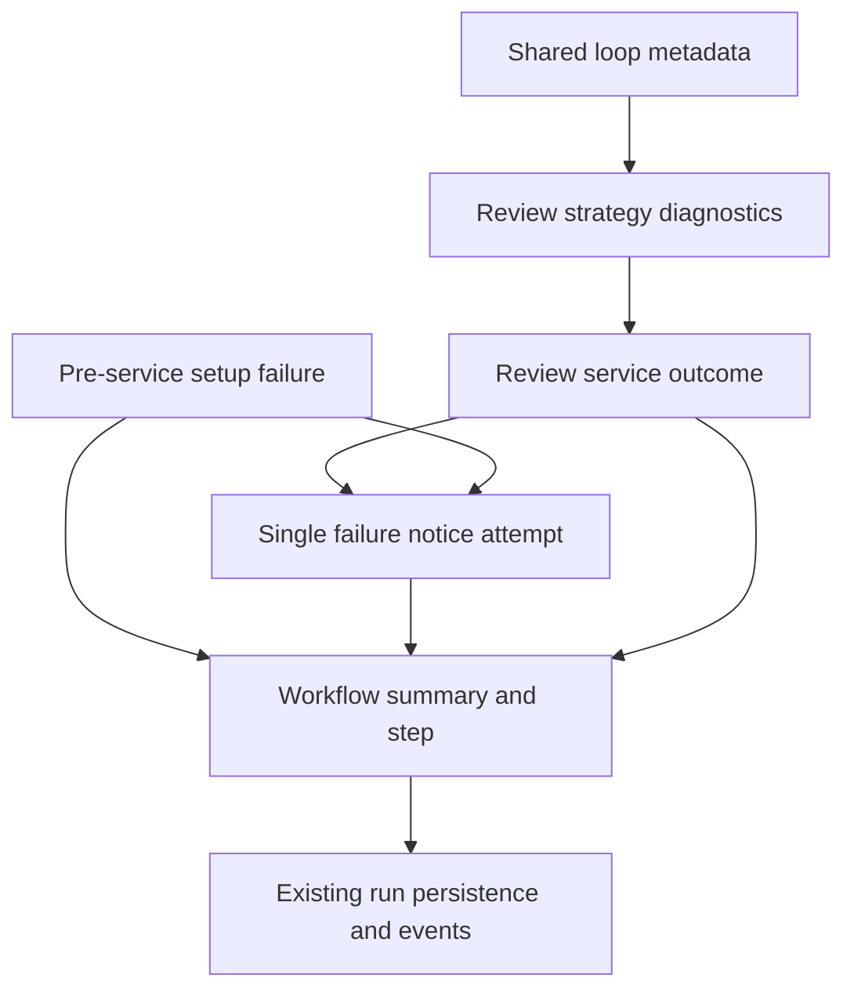

# fix: Explain agentic review failures

## Overview and Problem Frame

Preserve the actual reason an agentic review failed, expose bounded operator
diagnostics through existing run summaries/steps and bot logs, and attempt one
short PR failure notice. Do not alter exploration, completion, or formal review
decisions.

The inspected deployed run stopped on turn 11 after consuming 10 legacy context
rounds, with a 20-turn overall cap. Every observed turn had END_TURN; the model
continued requesting context. Repeated requests are suspected but unconfirmed.
The deployed client used /v1/completions, unlike this checkout's /completion.
Target this checkout; deployment reconciliation is a release prerequisite, not
permission to change the live server.

Origin: `docs/brainstorms/2026-10-10-local-agentic-review-requirements.md`.
Operators get actionable failure information; PR readers see a notice rather
than silence or authoritative-looking partial findings.

## Requirements Trace

| Origin | Implementation |
|---|---|
| R1: preserve distinct failure causes | Units 1, 2, 3 |
| R2: actual limiting budget and counts | Units 1, 3 |
| R3: correlated logs and existing run diagnostics | Units 1, 3 |
| R4: observe repeated requests without changing execution | Unit 1 |
| R5: exclude sensitive content from added diagnostics | All units |
| R6: short cause-specific PR failure notice | Units 2, 3 |
| R7: one attempt, preserve primary and notification failures | Units 2, 3 |
| R8: unchanged completion, success, skip, and clarification parity | All units |

## Scope Boundaries

- No server/container changes, live PR writes, deployment, or replay during
  planning. Any later live operation requires separate permission.
- No changed budgets, reserved final-answer phase, repeated-request suppression,
  retries, model fallback, prompt/template changes, or endpoint modernization.
- No new dashboard, dependencies, database schema, or workflow status values.
- No general redesign of audit privacy policies or other workflows.
- Do not correct the existing orchestrator's REVIEW_FAILED event treatment of
  skipped runs as part of this work; preserve no-diff behavior.

## Context and Research

### Relevant Code and Patterns

- Java 21, Spring Boot 4, Maven, JUnit Jupiter, Mockito, and AssertJ.
- `src/main/java/org/remus/giteabot/agent/loop/LoopOutcome.java` already allows
  domain-specific payloads. Keep its record shape and other strategies intact.
- `src/main/java/org/remus/giteabot/agent/loop/AgentLoop.java` knows the total
  turn number, actual ChatTurn metadata, effective token cap, and full prompt
  size. Its current logs lack review-specific run correlation.
- `src/main/java/org/remus/giteabot/agent/loop/AgentRunContext.java` already
  supports optional per-run callbacks. Follow that opt-in pattern for a
  metadata-only round observer.
- `src/main/java/org/remus/giteabot/prworkflow/agentreview/ReviewAgentStrategy.java`
  counts consumed legacy context rounds and rejects incomplete turns before
  parsing/execution. Preserve that ordering.
- `src/main/java/org/remus/giteabot/prworkflow/agentreview/AgentReviewService.java`
  silently returns FAILED for expected failures, posts workspace errors
  directly, and uses a separate exception notice containing raw error text.
  Diff fetch and head resolution occur outside its main try block.
- `src/main/java/org/remus/giteabot/prworkflow/WorkflowResult.java` provides a
  persisted summary; `PrWorkflowContext.appendStep` provides detailed excerpts.
- `src/main/java/org/remus/giteabot/prworkflow/PrWorkflowRunService.java`
  bounds summaries to 2,000 characters and step excerpts to 8 KiB.
- `src/main/java/org/remus/giteabot/prworkflow/PrWorkflowOrchestrator.java`
  persists summaries, includes them in completion audit/events, and retains
  terminal cancellation state. No new audit event is required.
- `src/test/java/org/remus/giteabot/prworkflow/agentreview/AgentReviewCompletionTest.java`
  currently prohibits all publication on incomplete runs. Refine assertions
  to allow a safe notice while still forbidding partial/formal reviews.

### Institutional Learnings and External Guidance

No matching requirements/plan or `docs/solutions` artifacts were found before
this brainstorm. The historical agentic review plan in
`doc/work/AGENTIC_PR_REVIEW_PLAN.md` is not authoritative: its proposed budget
fallback contradicts the current strict completion checks.

OWASP's Logging Cheat Sheet recommends interaction correlation, excluding
source/credentials/internal addresses, sanitizing untrusted fields, and keeping
logging failures from disrupting application behavior. Use these principles
for the added diagnostics; do not transmit repository content externally.
Reference: https://cheatsheetseries.owasp.org/cheatsheets/Logging_Cheat_Sheet.html

## Key Technical Decisions

- **Domain-specific snapshots, not shared result redesign:** carry an immutable
  review failure snapshot in failed LoopOutcome payloads. Use a review-local
  accumulator for observation, not mutable state shared between runs.
- **Additive service result:** retain the existing ReviewResult enum and
  compatibility entry points. Add detailed result entry points returning status,
  safe failure details, and notice delivery state for the workflow. Both paths
  delegate to the same execution/notification implementation.
- **Reuse persistence:** a short category/count summary goes in WorkflowResult;
  a bounded sanitized diagnostic excerpt goes in the existing workflow step.
  Do not widen generic audit or workflow persistence contracts.
- **Service-owned notification:** expected outcomes and exceptions converge on
  one review-local reporter. The workflow only uses this reporter for failures
  before a service exists, such as factory setup. It must not re-notify a result
  whose service already attempted a notice.
- **Allowlisted classification:** identify setup, provider call, empty output,
  completion, loop/context budget, and publication failures by controlled
  execution stage and normalized metadata. Never classify by arbitrary model
  prose or publish exception messages. A thrown error anywhere inside the
  entire review loop is not sufficient evidence of a provider request failure:
  identify that boundary inside AgentLoop, and use unknown for unclassified
  strategy/tool failures.
- **Repetition is exact normalized-request equality:** compare tool name and
  ordered arguments, or file request identity, ignoring generated IDs and JSON
  object key order. Preserve argument text and array order. Do not normalize
  paths or whitespace in ways that can change request semantics. Include the
  resolved repository ref/branch in the private equality identity; the same
  read on a different ref is not an identical context operation.
- **Private transient equality keys:** use a per-run keyed digest of canonical
  requests and retain only digests/counts in memory. Do not log keys, digests,
  paths, or arguments. Report duplicate-request occurrences and rounds containing
  a duplicate separately; count at most one repeated-round increment per turn.
- **Known limits only:** the actual AgentBudget and strategy cap are authoritative,
  not the workflow parameter label. Unknown counts/usage stay unavailable.

## Open Questions

### Resolved During Planning

- Existing operator surface: persisted workflow summary plus bounded step
  excerpt is sufficient; the orchestrator already propagates summaries.
- Round accounting: record a total turn when ChatTurn returns; consume a
  context round only when context gathering executes. A rejected eleventh
  request must not increment the ten consumed context rounds.
- Provider identity: derive validated provider type and integration ID from
  the service's Bot, not the wrapped AiClient class name. Missing integration
  information is explicitly unavailable; do not expose API URLs or display names.
- Clarification parity: pass its workflow run ID into the detailed service path;
  the current entry point does not provide it.
- Missing PR/client: record notice-not-attempted with a controlled reason.
  Do not make an invalid publication call.
- Existing raw audit capture remains unchanged. All newly added fields/notices
  use allowlisted metadata and bounded formatting.

### Deferred to Implementation / Release

- Exact helper names and snapshot representation: finalize within these
  boundaries without changing shared outcomes or introducing a framework.
- Deployed image provenance: identify its source revision through approved
  build/release metadata before rollout. The local plan remains executable
  without assuming the live image matches HEAD.
- Transport usage precision: use existing ChatTurn values; if metadata cannot
  distinguish missing token usage from zero, mark it unavailable rather than
  changing provider parsers in this slice.

## Implementation Units

- [x] **Unit 1: Collect safe review failure and repetition diagnostics**

**Goal:** Preserve terminal cause and accurate per-run observations.

**Requirements:** R1-R5, R8.

**Dependencies:** None.

**Files:**
- Create: `src/main/java/org/remus/giteabot/prworkflow/agentreview/ReviewDiagnostics.java`
- Modify: `src/main/java/org/remus/giteabot/prworkflow/agentreview/ReviewAgentStrategy.java`
- Modify: `src/main/java/org/remus/giteabot/agent/loop/AgentRunContext.java`
- Modify: `src/main/java/org/remus/giteabot/agent/loop/AgentLoop.java`
- Test: `src/test/java/org/remus/giteabot/prworkflow/agentreview/ReviewDiagnosticsTest.java`
- Test: `src/test/java/org/remus/giteabot/prworkflow/agentreview/ReviewAgentStrategyLegacyTest.java`
- Test: `src/test/java/org/remus/giteabot/agent/loop/AgentLoopTest.java`
- Test: `src/test/java/org/remus/giteabot/agent/loop/AgentLoopNativeToolResultTest.java`

**Approach:** Add a small review-local failure category/snapshot and per-run
accumulator. Add an optional metadata-only observer to AgentRunContext, invoked
by AgentLoop after a returned turn, supplying round, mode, normalized stop
reason, reported tokens, effective output cap, and computed prompt-size estimate.
Label this size as an estimate of the loop's request representation, not the
exact adapter-serialized request size. Include a safe provider-call failure
boundary observation when callAiWithRetry finally throws, without changing
its retry behavior. No raw text, exceptions, or tool arguments cross this
observation callback. Keep call-attempt failure metadata separate from the
number of successfully returned turns.

ReviewAgentStrategy records context request equality before execution and
counts gathered context/output sizes without retaining raw content. Count
rejected repeated requests separately from executed context rounds. Preserve
completion validation before parsing or tool dispatch. Use distinct snapshots
for context exhaustion versus overall exhaustion, MAX_TOKENS, OTHER/invalid
completion, and empty feedback; do not reinterpret malformed text as a new
failure category or change existing parser behavior.

Follow AgentRunContext's optional callback pattern and LoopOutcome's opaque
payload convention. Observer/reporting errors must be explicitly logged using
safe static context without changing execution or masking a primary failure.

**Execution note:** Characterize existing completion and dispatch behavior
before refining failure publication assertions.

**Test scenarios:**
- Legacy fixture with context cap 10 and loop cap 20 asks again on turn 11:
  context exhaustion, 10 gathered rounds, 11 total turns.
- Native requests through overall cap: overall exhaustion, not legacy context
  exhaustion; dispatched calls and results remain unchanged.
- MAX_TOKENS, OTHER, empty END_TURN, and unexpected native calls in legacy
  mode retain rejection behavior and produce distinct safe diagnostics.
- Same request with fresh IDs/object-key order: duplicate detected; changed
  argument, ordered array, or resolved ref: not identical.
- Two duplicate requests in one turn: two duplicate occurrences, one repeated
  round; separate runs do not share counters or equality keys.
- Disabled observer and observer failure: existing execution/results remain
  intact, with explicit diagnostic failure logging for the latter.
- Missing provider usage: unavailable, not invented; serialized snapshots
  contain no raw content, paths, arguments, or digest material.
- A provider call throws after existing retries: provider-boundary failure.
  A strategy/tool throws after a completed provider turn: unknown execution
  failure, not mislabeled as a provider failure.

**Verification:** Exact limiting budget/counts survive in failure snapshots;
all other strategies run as before when no observer is installed.

- [x] **Unit 2: Return detailed outcomes and unify failure notices**

**Goal:** Every reachable review/clarification failure has one safe reporting
path while keeping failed outcomes failed.

**Requirements:** R1-R3, R5-R8.

**Dependencies:** Unit 1.

**Files:**
- Create: `src/main/java/org/remus/giteabot/prworkflow/agentreview/ReviewFailureReporter.java`
- Modify: `src/main/java/org/remus/giteabot/prworkflow/agentreview/AgentReviewService.java`
- Test: `src/test/java/org/remus/giteabot/prworkflow/agentreview/ReviewFailureReporterTest.java`
- Test: `src/test/java/org/remus/giteabot/prworkflow/agentreview/AgentReviewServiceTest.java`
- Test: `src/test/java/org/remus/giteabot/prworkflow/agentreview/AgentReviewCompletionTest.java`

**Approach:** Introduce an additive detailed result owned by the service, with
the existing enum as its status. Existing entry points delegate and project
that status, without duplicating execution or notice attempts. Both review
and clarification share safe formatting/reporting, not their whole execution
logic. Keep all accumulator state local to the invocation.

Bring diff acquisition, head resolution, and workspace setup failures into the
controlled failure boundary. Track the current stage so provider-call,
setup, and publication exceptions receive the right category, using the loop's
call-boundary observation rather than labeling all runReviewLoop exceptions
as provider failures. Consume failed
strategy payloads as diagnostic data, never as review text.

Replace direct workspace/error notices with the common reporter. Use a plain
PR comment operation, never a formal review. Mark the attempt before calling
the client; a notification exception yields a separate delivery-failed field
without a second attempt or masked original cause. Preserve workspace cleanup.
Log bounded category/count metadata at failure level without exception bodies;
sanitize provider/integration identifiers and user-controlled correlation data.

A notice states no completed review was produced, the reason, and one controlled
guidance sentence. Context-cap guidance names context exploration as the
limiting budget and suggests examining repeated requests. Output truncation
guidance identifies the effective output cap if known. Unknown completion
guidance directs the operator to run diagnostics, not an assumed timeout fix.
For publication failure after completed analysis, say the completed review
could not be published; do not falsely claim analysis was incomplete.

**Patterns to follow:** existing postPullRequestComment calls and service
workspace cleanup; detailed snapshots are immutable like ParseResult.

**Test scenarios:**
- Each available failure category: exactly one plain notice attempt and FAILED
  outcome. The notice never publishes partial findings, creates a formal
  decision, or emits a finding event; existing completed-review publication
  attempts before a publication failure remain permitted.
- Primary context exhaustion plus notice permission/network error: primary
  category survives, delivery failure recorded, no retry by the catch path.
- Missing head, workspace unsuccessful result/exception, diff-fetch exception,
  provider exception, and empty feedback converge on the common path.
- Missing PR identity/client: explicit notice-not-attempted; no invalid call.
- Successful review, formal-review fallback success, clarification answer,
  and no-diff skip: unchanged output and no failure notice.
- Completed review publication fails: publication category and accurate wording;
  existing formal-to-plain fallback is tried as before.
- Exception messages containing credentials/source/CRLF never appear in added
  notices or diagnostics.
- Compatibility wrappers and detailed entry points each execute once and
  notify once; independent runs retain separate attempt state.

**Verification:** Normal failure reporting never converts FAILED to success
and never interferes with successful publication, skips, or cleanup.

- [x] **Unit 3: Persist workflow diagnostics and cover setup/clarification parity**

**Goal:** The run record explains the failure and notification delivery outcome.

**Requirements:** R1-R3, R5-R8.

**Dependencies:** Unit 2.

**Files:**
- Modify: `src/main/java/org/remus/giteabot/prworkflow/agentreview/AgentReviewWorkflow.java`
- Test: `src/test/java/org/remus/giteabot/prworkflow/agentreview/AgentReviewWorkflowTest.java`
- Test: `src/test/java/org/remus/giteabot/prworkflow/PrWorkflowOrchestratorTest.java`
- Test: `src/test/java/org/remus/giteabot/prworkflow/agentreview/AgentReviewDiagnosticsIntegrationTest.java`
- Modify: `doc/PR_WORKFLOWS_AGENTIC_REVIEW.md`
- Modify: `doc/LLAMACPP.md`

**Approach:** Workflow uses detailed service outcomes for review and
clarification, passing the run ID to each. Return a concise controlled
WorkflowResult summary and append a bounded diagnostic excerpt through the
existing context. Include original category, known counts, mode/reason,
repetition observations, and notice attempted/delivered/failed/unavailable.
Do not repeat notices already attempted by the service.

Handle only pre-service setup/factory errors with the same reporter using the
existing repository-client factory when available; avoid rebuilding the
service or rediscovering MCP tools. Wire the minimum required reporter/factory
collaboration into AgentReviewWorkflow. If the client cannot be resolved,
return setup failure with notice unavailable. Preserve requireActive before
factory creation: cancellation remains cancellation with no added notice.

Do not catch step-persistence failures as if they were new review failures or
retry notification because recording diagnostics failed. Report persistence
failure safely in logs and retain the original failed summary where possible.
Let the existing orchestrator preserve already-terminal cancellation status.

**Patterns to follow:** existing WorkflowResult summary and context.appendStep
usage; existing orchestrator persistence/event mapping, unchanged.

**Test scenarios:**
- Detailed context exhaustion crosses real service/loop/workflow boundaries:
  one notice, category/counts in step and FAILED summary.
- Orchestrator persists that summary and propagates it in existing completion
  audit/events without changing status mapping or schema.
- Clarification run has the same correlation/notification behavior as review.
- Factory/MCP/prompt setup error before service creation: setup category and
  one notice if client resolution works, otherwise notice unavailable.
- Already-cancelled context: factory/service/reporter not invoked.
- Service already attempted notification, then step append fails: no second
  notice; safe logging preserves the primary cause.
- Output longer than run limits: bounded summary/excerpt with primary cause
  retained; notice contains no raw request or response material.
- Success and no-diff mapping retain existing behavior; failed notices never
  produce formal approvals or finding events.

**Verification:** Failure details are visible on the existing run surface,
independently of container DEBUG logging, with cross-layer fixture coverage.

## System-Wide Impact

> This illustrates the intended approach and is directional guidance for
> review, not implementation specification.

- Only review opts into round observation; coding/writer/E2E strategies keep
  existing shared loop behavior and outcome contracts.
- Reviews and clarifications converge at the reporter. Factory failures join
  only before service ownership begins.
- Notice posting is an external side effect. Guarantee one application-level
  attempt, not distributed exactly-once delivery. Separate later reruns may
  legitimately post their own notice.
- A delivery or persistence failure cannot hide the review failure or trigger
  a second notice. Existing retry notices and raw audit policies remain intact.
- Shared workflow result/status/schema and completion audit behavior remain
  unchanged; only this workflow's safe summaries/excerpts become richer.

## Risks and Dependencies

| Risk | Mitigation |
|---|---|
| Inflated scope through shared contracts | Opt-in observer; domain payload/result; no audit/schema redesign |
| Sensitive data leakage | Allowlisted fields and controlled templates; no exception/model text; privacy fixtures |
| Duplicate notices | Single invocation-local attempt state and explicit service/factory ownership |
| Misleading repeated-request signal | Exact normalized equality; report observation, not cause; separate round/occurrence counts |
| Observation memory cost | Digest/count state bounded by actual run/request limits; no raw transcript retention |
| Diagnostic recording changes execution | Observer failures safely logged; no strategy/budget effects; no re-notification |
| Publication wording implies analysis failure | Distinguish completed analysis with failed publication |
| Deployed source mismatch | Reconcile approved image provenance before rollout; no live changes assumed |

## Documentation and Operational Notes

Describe notice categories, run-summary/step fields, legacy versus total-round
limits, repetition indicators, and unavailable metadata in the workflow guide.
The llama.cpp troubleshooting guide should point to these diagnostics rather
than claiming larger models or budgets necessarily fix this failure.

Plan requires no new configuration defaults or migration. During an authorized
rollout, verify a controlled failing run exposes the correct limiting budget
and one notice; inspect privacy and successful-review parity. Do not replay
production runs or post live test comments without permission.

## Sources

- Origin: `docs/brainstorms/2026-10-10-local-agentic-review-requirements.md`
- Source and test paths are listed above.
- Deployment evidence: user-authorized read-only Compose logs; context-cap
  failure confirmed, request repetition not confirmed.
- External privacy guidance:
  https://cheatsheetseries.owasp.org/cheatsheets/Logging_Cheat_Sheet.html
