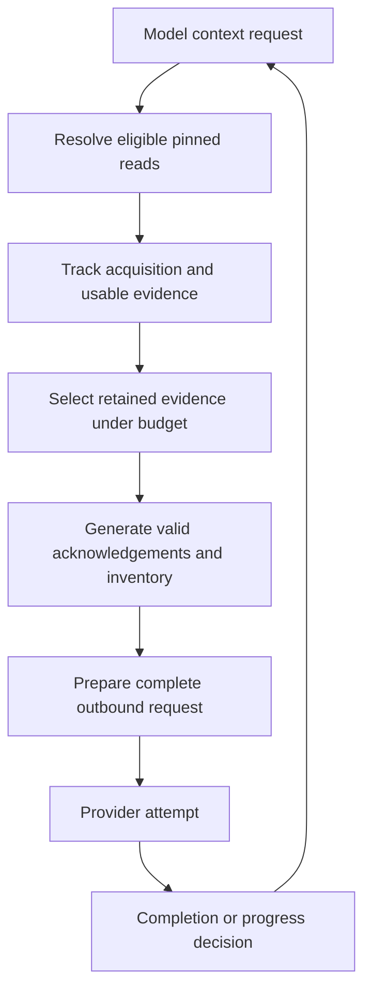
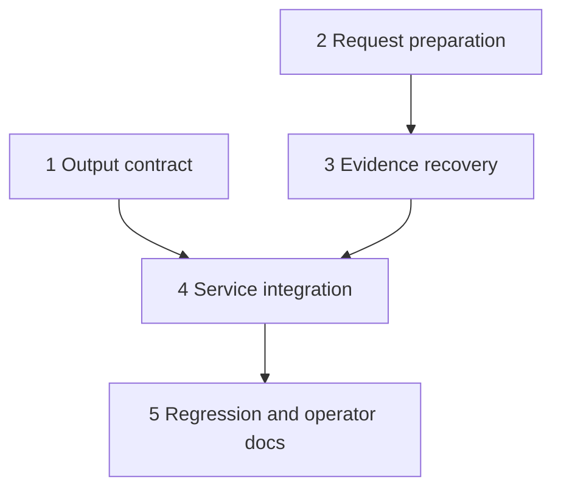

# fix: Bound legacy Agentic Review recovery

## Overview and Problem Frame

Run 128 repeatedly requested evidence already returned by the legacy review
strategy, growing the request to approximately 795,154 characters before
exhausting context rounds. Caching saved fetches but not prompt replay.
Separately, fenced completion instructions contradict llama.cpp's bare-object
grammar; unavailable raw transcripts prevent attributing the stall to that
conflict. Repair both the contract and the confirmed repetition/replay path.

The completed diagnostics work and merged stale-diff-awareness implementation
remain the baseline. This plan implements the separate recovery origin, not
another diagnostics-only phase.

| Mode | New recovery behavior | Preserved behavior |
|------|-----------------------|--------------------|
| Full legacy review | Bare JSON, bounded evidence, one recovery turn | Grounding, fences, publication gates |
| Native review | None | Native tool exchange and budgets |
| Clarification | None | Existing Markdown answers and history |

## Requirements Trace

- R1-R2: One bare exploration or completion object; distinct examples;
  optional classification inside the completed envelope.
- R3-R5: Per-operation/per-file identity and actual retained evidence determine
  suppression. New or restored usable evidence resets recovery; duplicate
  plus failed/identical reads does not. A second consecutive stalled response
  fails, without extra round allowance.
- R6-R8: Prepare every outbound request, including provider retries, under
  history and context policies with output headroom. Preserve task, immutable
  revision, output contract and a bounded inventory. Excerpts explicitly
  identify source/ref/regions/omissions and narrower-read guidance.
- R9: Completed reviews with known unresolved acquisition limitations are
  disclosed and degraded, never approved. Unfinished output still fails.
  Eviction alone does not imply unresolved acquisition.
- R10: Typed mandatory-context and stalled-context failures; distinguish
  requested/executed/suppressed counts without exposing evidence identities.

## Scope Boundaries

No native transport modernization, model/server upgrade, new tokenizer service,
raised limits, transcript capture, database migration, exhaustive repository
reads or general agent framework. Remote Compose access remains read-only;
deployment and live replay require separate permission. All execution-time
builds and tests use local Podman.

## Context and Research

`ReviewAgentStrategy` currently renders every requested result unconditionally.
`AgentLoop` compacts after provider responses and only truncates tool messages;
legacy evidence is in user messages. `HistoryCompactor` preserves minimum
exchange units rather than mandatory task or source availability.
`PinnedSourceReader` caches immutable content, not effective prompt availability.

Follow existing `ReviewFence`, REVIEW router, `GroundingResult.summaryNotes`,
degraded approval guards, typed diagnostics and one-notice failure reporting.
Prior grounded-review planning distinguishes pinned acquisition from current
head validation and lease fencing; preserve all three. `docs/solutions` is
absent, so no institutional solution documents were available.

Official llama.cpp server documentation identifies context size and grammar
controls: https://github.com/ggml-org/llama.cpp/blob/master/tools/server/README.md.
Do not assume newer server functionality exists in this deployment.

## Key Technical Decisions

| Decision | Rationale and rejected alternative |
|----------|-----------------------------------|
| Full legacy review opt-in only | Avoid changing shared writer/native/clarification behavior |
| Review-local evidence ledger | Fetch cache alone cannot prove availability; generic framework unnecessary |
| Prepare before every attempt | Post-response compaction and provider rejection are too late |
| Separate availability and acquisition coverage | Eviction permits refetch but must not falsely degrade acquired coverage |
| Nested classification | One grammar-compatible object; retain old parsing compatibility |
| Conservative serialized-request estimate | No exact tokenizer exists; reserve output and margin without exact-fit claims |

The preparation seam is default-off. It can prune review history and regenerate
the current evidence continuation before sending. Evidence acknowledgements
must be generated only after final retention selection; if B displaces A,
remove A's acknowledgement or restore A within the budget. Avoid retaining
multiple historical copies of source evidence.

Account for provider representation, including llama.cpp ChatML wrappers.
Prefer a small default sizing capability with a llama.cpp override sharing
its prompt rendering rather than duplicating transport construction. Delegating
AI wrappers must preserve sizing capabilities. If no exact count exists, use a
documented conservative byte/character policy, reserve configured output
tokens, and apply context threshold/margin. Policy fit is not a token guarantee.
Retain the two-attempt prompt-too-long fallback, re-preparing after compaction.
Internal transient retries in `RetryAiClient` reuse the same immutable prepared
request; they do not change evidence or require another retention selection.
Validate sizing through wrappers and a non-llama.cpp legacy client as well.

## Open Questions

### Resolved During Planning

- Formal metadata: nested classification in the completed envelope; production
  decisions remain derived from grounded findings, not model counts.
- Availability metadata: track delivered content/regions and retained request
  associations privately, never emit raw keys in operator diagnostics.
- Optional oversize: bounded line-aware excerpts, explicit omitted regions,
  narrower-read guidance. Failed/empty reads are never complete source evidence.
- Coverage: previously acquired complete evidence remains acquired after
  eviction; failed/truncated requested evidence remains unresolved until
  subsequently satisfied. Merge trusted limitations before publication.
- Recovery: non-progress context turns use one recovery opportunity; subsequent
  non-progress terminates. Actual delivery resets it. Overall rounds are always
  consumed; context operations retain the existing cap.
- Budget precedence: stall on the second non-progress response; when a cap
  prevents another response, report that cap instead of granting extra turns.

### Deferred to Implementation

- Exact helper names and smallest evidence representation after integrating
  existing parser/tool result shapes.
- Conservative estimator constants validated against serialized requests;
  not calibrated from one live run and not advertised as exact tokenization.
- Fine-grained region reconciliation for built-in reads: add only metadata
  necessary to recognize delivered regions, preserving authorized tool routing.

## High-Level Technical Design

> This illustrates the intended approach and is directional guidance for review,
> not implementation specification. Treat it as context, not code to reproduce.

## Implementation Units

- [x] **Unit 1: Grammar-compatible review contract**

**Goal / Requirements:** R1-R2. Full legacy review instructions use one bare
object for exploration and completion; formal metadata nests inside it.

**Dependencies:** None.

**Files:** Modify `src/main/java/org/remus/giteabot/review/ReviewOutputInstructions.java`,
`src/main/java/org/remus/giteabot/agent/shared/LegacyToolProtocolRenderer.java`,
`src/main/java/org/remus/giteabot/agent/shared/SystemPromptAssembler.java`.
Test `src/test/java/org/remus/giteabot/review/ReviewOutputParserTest.java`,
`src/test/java/org/remus/giteabot/agent/shared/SystemPromptAssemblerTest.java`.

**Approach / Patterns:** Add a distinct review prompt kind, not a writer prompt
rewrite. Preserve bare/fenced parser compatibility. Service parser integration
belongs to Unit 4.

**Test scenarios:** Exploration and completed examples are valid single JSON
objects; nested classification preserves summary/findings; writer/native
prompts and clarification instructions remain unchanged.

**Verification:** No full legacy final instruction requires fences or trailing
classification objects.

- [x] **Unit 2: Opt-in pre-send request preparation**

**Goal / Requirements:** R6-R8. Shared loop offers default-off preparation before
each attempt, preserving mandatory task and output headroom.

**Dependencies:** None; coordinate seam with Unit 3.

**Files:** Modify `src/main/java/org/remus/giteabot/agent/loop/AgentLoop.java`,
`src/main/java/org/remus/giteabot/agent/loop/AgentStrategy.java`,
`src/main/java/org/remus/giteabot/ai/AiClient.java`,
`src/main/java/org/remus/giteabot/ai/llamacpp/LlamaCppClient.java`;
delegating AI wrappers as necessary.
Test `src/test/java/org/remus/giteabot/agent/loop/AgentLoopTest.java`,
`src/test/java/org/remus/giteabot/ai/llamacpp/LlamaCppClientTest.java`.

**Approach / Patterns:** Preparation receives final history/current request and
budget/client sizing, runs before every retry, and communicates mandatory fit
failure explicitly. Do not globally change `HistoryCompactor` minimum units.

**Test scenarios:** Oversized initial/current legacy user input is bounded
before call; mandatory-only overflow fails without provider call; ChatML
wrappers included; provider prompt-too-long retry re-prepares; non-opt-in
native/writer paths unchanged; network retry remains bounded.

**Verification:** Captured outbound request representations meet configured
policy including reserved output; tests distinguish estimate from exact count.

- [x] **Unit 3: Availability-aware evidence and bounded recovery**

**Goal / Requirements:** R3-R8, R10. Private review-local evidence ledger,
line-aware excerpts, valid final acknowledgements and one recovery opportunity.

**Dependencies:** Unit 2 seam.

**Files:** Modify `src/main/java/org/remus/giteabot/prworkflow/agentreview/ReviewAgentStrategy.java`,
`src/main/java/org/remus/giteabot/prworkflow/agentreview/ReviewDiagnostics.java`;
create focused review-local helpers only when necessary.
Test `src/test/java/org/remus/giteabot/prworkflow/agentreview/ReviewAgentStrategyLegacyTest.java`,
`src/test/java/org/remus/giteabot/prworkflow/agentreview/ReviewDiagnosticsTest.java`.

**Approach / Patterns:** Retain old constructors/default behavior. Full legacy
service opts in. Split file batches per source; identities preserve meaningful
args/order/ref and ignore generated IDs. Route all tool calls through REVIEW
and existing fences. Track coverage independently of retained availability.
No-progress errors/identical excerpts never reset recovery. Expose trusted
coverage notes to Unit 4 without changing success into a fallback.
The existing REVIEW deny-by-default builtin policy remains authoritative:
recovery must reject mutation requests, retain the authorized immutable ref on
every refetch, and stop further reads/publication after lease loss. Selected MCP
tools remain operator-authorized read-only capabilities, not a new allowlist.
An incomplete full-file request clears only after complete same-source/ref
acquisition, or verified delivered line intervals collectively covering it.
Unknown total coverage stays unresolved; narrower reads alone are not proof
that an earlier full-file request was satisfied.

**Test scenarios:** Two new batches followed by duplicate gets one recovery;
next duplicate fails; progress resets; changed IDs duplicate but changed
args/ref do not; overlapping A+B sends only new B alongside valid A reference;
B-evicts-A never references absent A; evicted A refetches; repeated identical
excerpt gets narrower guidance; omitted line request remains eligible;
duplicate+failed read stalls; failure-only reads bounded; caps not raised;
diagnostics contain only safe counts/categories.
Also cover post-response compaction between turns; partial reads cannot clear
an original full-file limitation without verified complete same-ref coverage.

**Verification:** Tests inspect final prepared history/current message, not
cache membership. Requested/executed/suppressed counters remain distinct.

- [x] **Unit 4: Service coverage and publication integration**

**Goal / Requirements:** R1, R9-R10. Enable recovery only for full legacy
reviews; propagate unresolved evidence to degraded summary/state before
formal-decision/publication gates.

**Dependencies:** Units 1-3.

**Files:** Modify `src/main/java/org/remus/giteabot/prworkflow/agentreview/AgentReviewService.java`,
`src/main/java/org/remus/giteabot/prworkflow/agentreview/ReviewFailureReporter.java`.
Test `src/test/java/org/remus/giteabot/prworkflow/agentreview/AgentReviewCompletionTest.java`,
`src/test/java/org/remus/giteabot/prworkflow/agentreview/AgentReviewServiceTest.java`,
`src/test/java/org/remus/giteabot/prworkflow/agentreview/ReviewFailureReporterTest.java`.

**Approach / Patterns:** Single-file pinned fetches provide honest completeness
metadata; do not silently truncate concatenated batches before the ledger.
Preserve String payload compatibility where possible, with private coverage
handoff. Merge trusted notes into `GroundingResult` before decision/publication.
Extract nested classification without stripping the entire review envelope.

**Test scenarios:** Clean final review with failed or incomplete requested
source publishes disclosed degraded state and never approves; completed
coverage later evicted does not degrade; nested and historical formal metadata
preserve findings; stalled/incomplete/truncated output posts one failure notice,
no review; clarification/native/no-diff/skip/cancellation/lease loss unchanged.
Include recovery-specific forbidden-write/refetch and lease-loss regressions.

**Verification:** Persistent revision degraded flag and actual publication
summary/actions reflect acquisition limitations.

- [x] **Unit 5: Regression, documentation and rollout handoff**

**Goal / Requirements:** All origin success criteria.

**Dependencies:** Unit 4.

**Files:** Update `doc/PR_WORKFLOWS_AGENTIC_REVIEW.md`, `doc/LLAMACPP.md`;
test `src/test/java/org/remus/giteabot/prworkflow/agentreview/AgentReviewDiagnosticsIntegrationTest.java`
and existing loop/native/grounding/workflow/publication tests.

**Approach:** Document conservative sizing, recovery failure versus degraded
completion, unchanged limits and no compatibility guarantee. Characterize
run-128 analogue deterministically, then exercise affected regression suites.

**Test scenarios:** Captured provider requests demonstrate no repeated full
evidence growth; final attempt budgeting and failure notices verified;
publication and stale-diff/lease regressions remain passing.

**Verification:** Local Podman validation succeeds. Live same-PR/model/limits
replay remains a separately authorized operational check, not a test proxy.

## System-Wide Impact and Risks

Strategy -> preparation -> provider -> completion -> grounding -> publication
is the affected interaction graph. Preparation exceptions must become typed
failures, not success-shaped empty context. Source identities stay private to
the run; summaries disclose bounded acquisition limitations without dumping
source or arguments. No persisted schema changes.

| Risk | Mitigation |
|------|------------|
| False suppression after compaction/retry | Generate acknowledgements from final retained evidence and test wire shape |
| Estimator differs from tokenizer | Conservative margin/headroom plus existing bounded rejection retry |
| Coverage falsely clean or degraded | Separate acquisition and availability; integration tests persist state |
| Shared loop regressions | Default-off seam; retain existing native/clarification tests |
| Formal parser eats completed envelope | Nested metadata compatibility characterization |
| Concurrent implementation conflicts | Non-overlapping unit ownership; service integration follows joined units |

## Documentation and Operational Notes

No server write, deployment or live trigger is part of local execution.
Operators rebuild/deploy only with explicit permission and retain immutable
rollback provenance. A later replay must show grounded completion or explicit
bounded stall; one success does not prove universal model compatibility.

The SLFG helper is absent. Infer resumability from this plan, branch changes and
review artifacts rather than adding unrelated hook tooling.

## Sources

- Origin: `docs/brainstorms/2026-10-10-legacy-agentic-review-recovery-requirements.md`
- Diagnostics history: `docs/plans/2026-10-10-001-fix-agentic-review-failure-diagnostics-plan.md`
- Grounding history: `docs/plans/2026-10-08-001-feat-grounded-re-reviews-plan.md`
- Official provider reference linked in Context and Research.

## Execution Findings

- Initial integrated validation exposed a coverage bug: a successful full-file
  fetch was counted as complete even when the outbound request retained only an
  excerpt. Acquisition coverage now derives from actual delivered regions;
  pending retry retention replaces provisional coverage rather than certifying
  fetched-but-omitted source.
- An oversized requested source must leave a completed zero-findings review
  degraded and prohibit approval. Service regression coverage exercises this
  boundary together with unavailable-source reads and same-ref recovery.
- Browser validation is inapplicable: this change affects backend Java and
  documentation, not routes, views, styles or components. No browser or server
  was started, and no live review was triggered.
- Independent review identified remaining retry-boundary, omitted-source
  inventory, source-line splitting and tool EOF/empty-result cases. The final
  retry must not grant an extra recovery turn if its retention removes tentative
  progress. Inventory labels must survive source eviction within the same budget.
- Regression assertions must prove application-owned coverage disclosure, not
  merely match wording already present in a model summary. Historical fenced
  envelopes with trailing classification remain accepted for compatibility.
- Bounded second review confirmed six of seven findings resolved. Source
  splitting was corrected, but numbered tool-line regex matching also needs
  DOTALL to preserve Unicode separators inside source lines without falsely
  reporting truncation.
- Conservative cleanup moved the generic exchange-compaction comment into its
  actual branch. The compatibility diagnostic constructor is intentionally
  retained because preserving callers is an explicit scope invariant.
- Affected regression suites and final targeted fixes pass in local Podman,
  including Unicode numbered-source parsing, retry stall enforcement, trusted
  coverage disclosure and lease loss during a singleton file fetch.
- Feature-video is not recorded: there is no changed browser surface, and no
  live workflow demonstration or server mutation is authorized. Implementation
  completion does not imply deployment or a verified live model replay.
